# Acoustic Analysis Report - tile tap testing

Draft for the team to rewrite in its own words before any college submission.
Data: station sessions of 2026-10-19, labelled 2026-10-22. Figures: `docs/report_figures/`
(regenerate with `python tools/make_screenshots.py`, `tools/make_report_figures.py` and the three
`tools/*.py` comparison scripts).

## 1. Summary

- The Acoustic-Analysis app records or imports a tap, measures how a tile rings, and can grade it against tiles a
  person labelled good.
- On real strikes, the sound of a tile is clearly different from the striker alone (section 5.2), so a strike can be
  heard and cut reliably.
- **Good and cracked tiles could not be told apart from this data** (section 6). Cracked tiles were 1-2.5 dB quieter
  in the low and mid bands and had a slightly higher centroid, but no difference is statistically reliable
  (smallest permutation p = 0.11) and only **5 cracked tiles** exist.
- So the sound grade must not be used for sorting yet. More labelled cracked tiles, a calibrated microphone and a
  repeatable striker are needed (section 8).

## 2. Rig and method

| Part | Detail |
|---|---|
| Striker | one sprung solenoid above the tile, driven by an Arduino Nano; energised = lifted, released = gravity + spring strike |
| Tile sensor | VL53L0X time-of-flight; a tile reads about 91 mm, empty surface 112-149 mm |
| Microphone | USB ("USB PnP Audio Device"), 48 kHz mono, mic gain 150 in the session notes |
| Clip | 1.5 s cut around each strike, strike about 0.5 s in (observed 0.47-0.57 s) |
| Analysis | waveform, spectrum, 1/3-octave bands, Schroeder energy-decay curve, spectral descriptors (`docs/METHODS.md`) |
| Sound grade | median and 1.4826 x MAD of tiles labelled good; worst robust z-score decides GOOD / BORDERLINE / DEFECTIVE |

## 3. The app (screenshots)

Screens 1-7 and 10-20 were captured from the real app on **synthetic demo data** (`tools/make_screenshots.py`), so the
numbers in them are not tile measurements. Screens 8, 9 and 21 use real clips from the 2026-10-19 sessions. Monitor and
Record are shown idle: no microphone, Nano or tile was connected when they were captured.

| | |
|---|---|
| 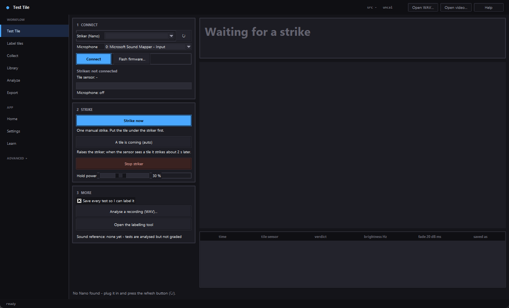 **Collect - Setup.** Records the motor and the striker alone so both can be subtracted from every tap. |  **Collect - Listen.** Sound-triggered capture with a live level bar and adaptive threshold. |
|  **Collect - Review.** Each capture is sorted tile / no tile / no strike; the chart overlays as recorded vs cleaned. | 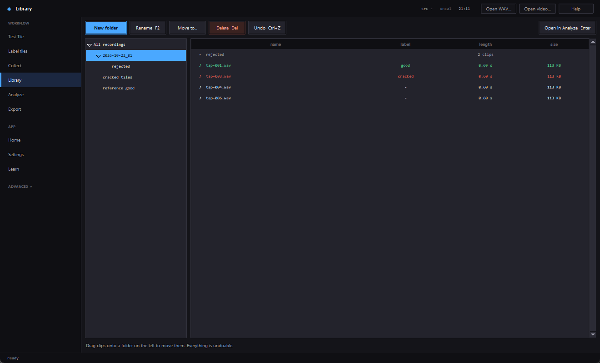 **Library.** File manager for recordings; keeps the WAV, sidecar and database path in step. |
| 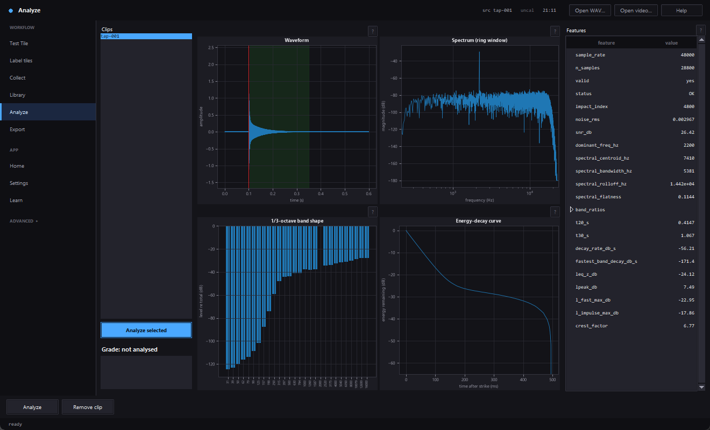 **Analyze.** Waveform with strike and ring window, spectrum, 1/3-octave shape, energy-decay curve and the feature table. | 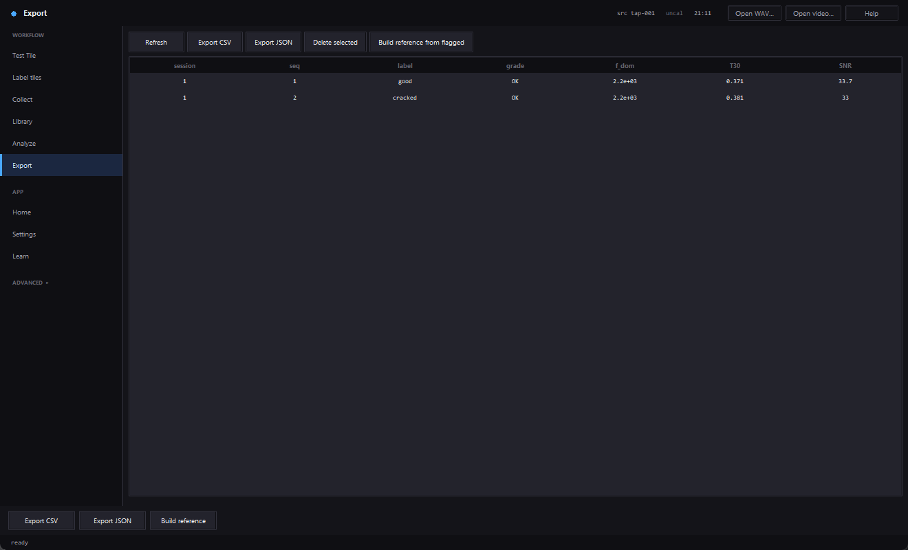 **Export.** Labelled clips with key measurements, to CSV / JSON for training. |
| 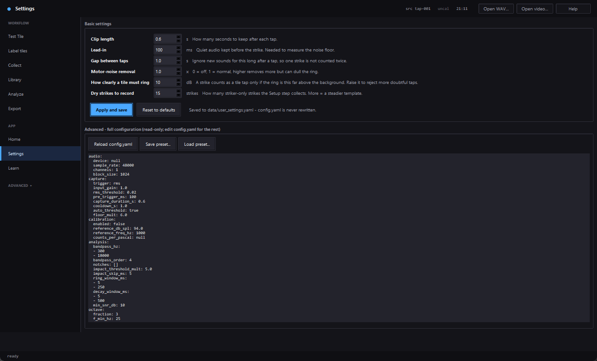 **Settings.** Plain-language basic settings. | 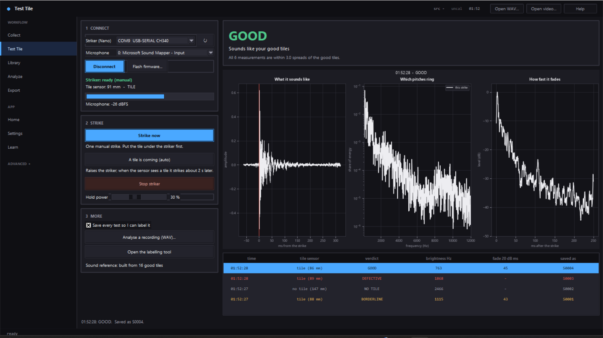 **Test Tile.** Strike, record, analyse and verdict in one screen (here a fake Nano; the verdict uses a throwaway reference, not labelled tiles). |

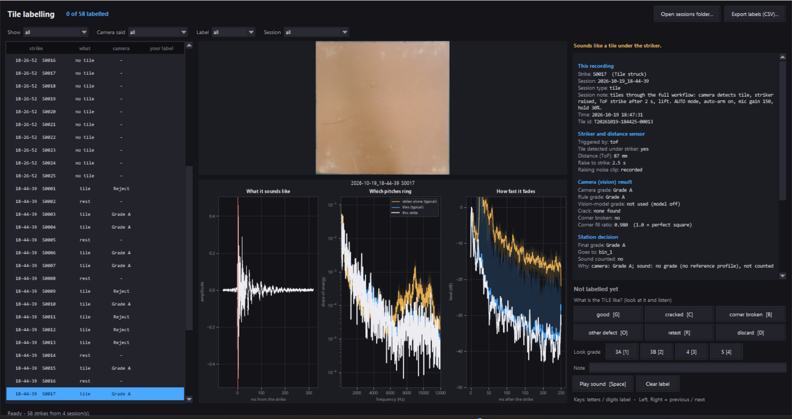

**Labelling tool** (real station data). Tile picture, camera verdict, the three sound plots (what it sounds like,
which pitches ring, how fast it fades, with the striker-alone and typical-tile curves behind) and the label buttons.

### 3.1 Remaining screens

| | |
|---|---|
| 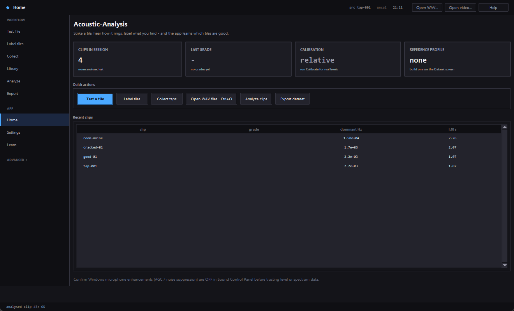 **Home.** Launcher with the session summary: clip count, last grade, calibration and reference state, recent clips. |  **Learn.** The explanations behind every "?" panel, with a synthetic decaying tone to play with. The text column is narrow in this build. |
|  **Label tiles.** The three-step explainer, label counts, and the button that opens the labelling tool. | 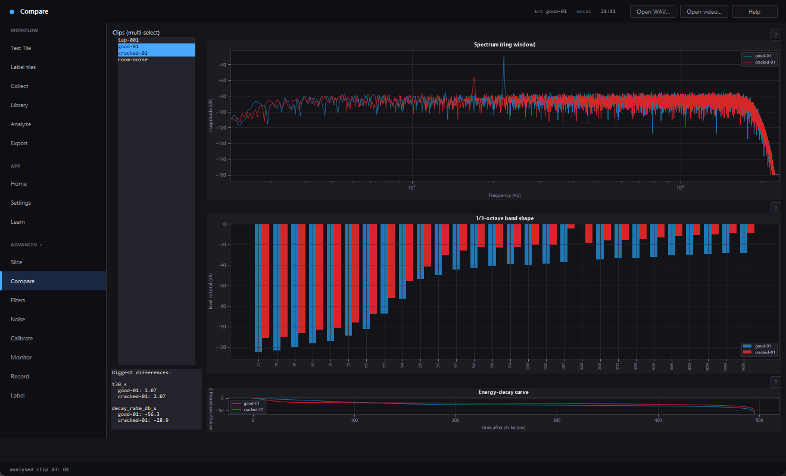 **Compare** (ADVANCED). Two clips overlaid: spectrum, 1/3-octave shape and energy decay, with a list of the biggest feature differences. Here a good and a cracked demo clip. |
| 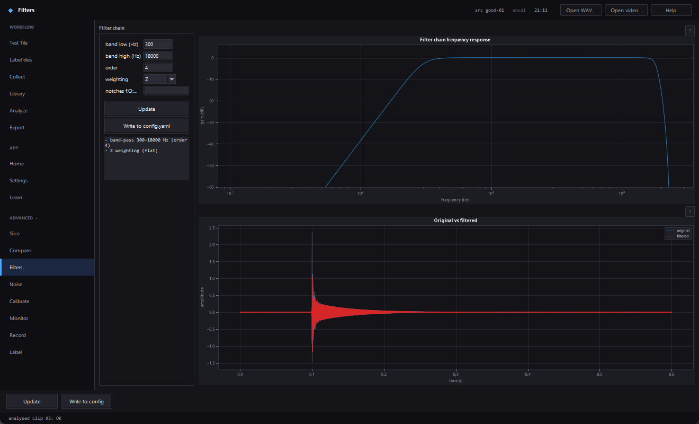 **Filters.** Band-pass / notch / weighting chain, its frequency response and original vs filtered signal. |  **Noise.** Denoise preview from a noise-profile clip, plus the environment summary (Leq, percentiles, NC, tones). |
| 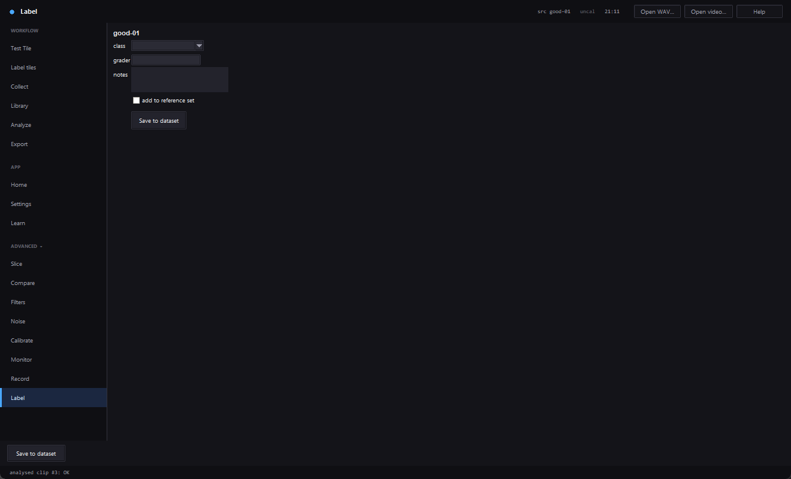 **Label** (ADVANCED). Class, grader and notes for the selected clip, saved to the dataset. | 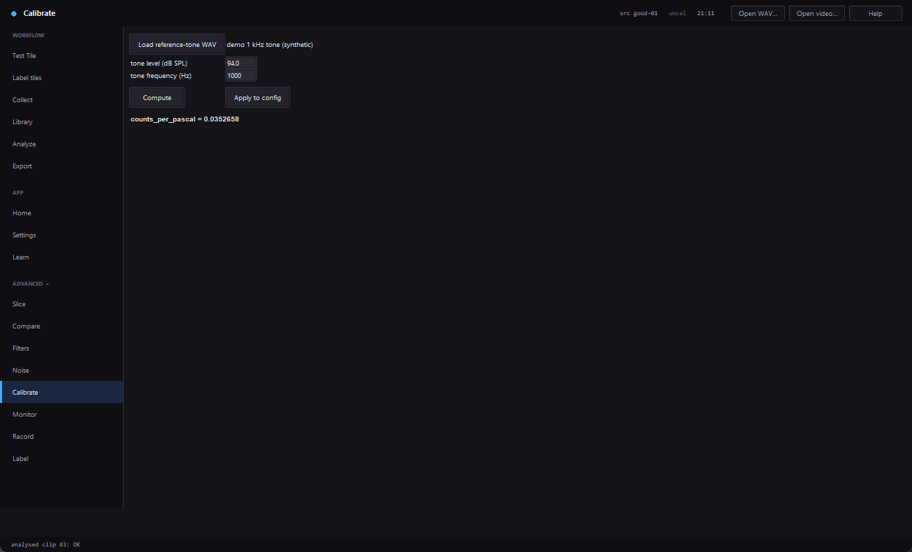 **Calibrate.** Counts-per-pascal from a reference tone. Here a synthetic 1 kHz tone; **Apply was not pressed**, so nothing was written to the config. |
| 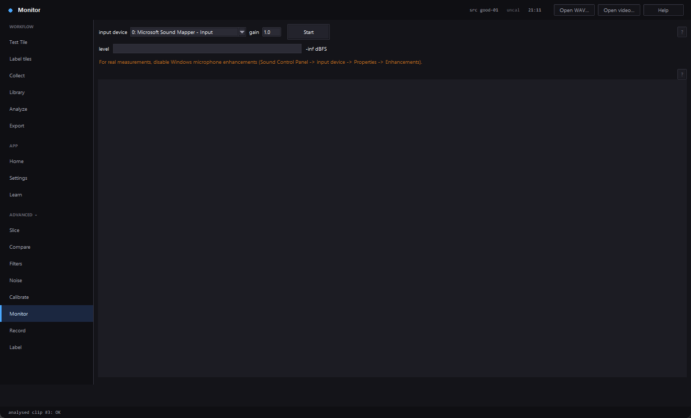 **Monitor** (idle). Live level and spectrogram; needs a microphone. |  **Record** (idle). Manual or RMS-triggered recording; needs a microphone. |

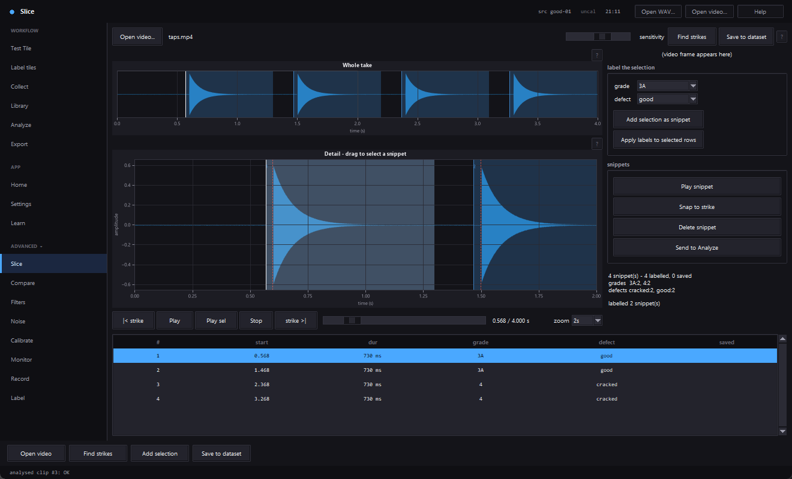

**Slice.** A tap-test video (here a generated test video with four synthetic taps): the whole take with detected
strikes, the detail view, and the snippet table with grade tier and defect labels. Slice has still never seen real
footage.

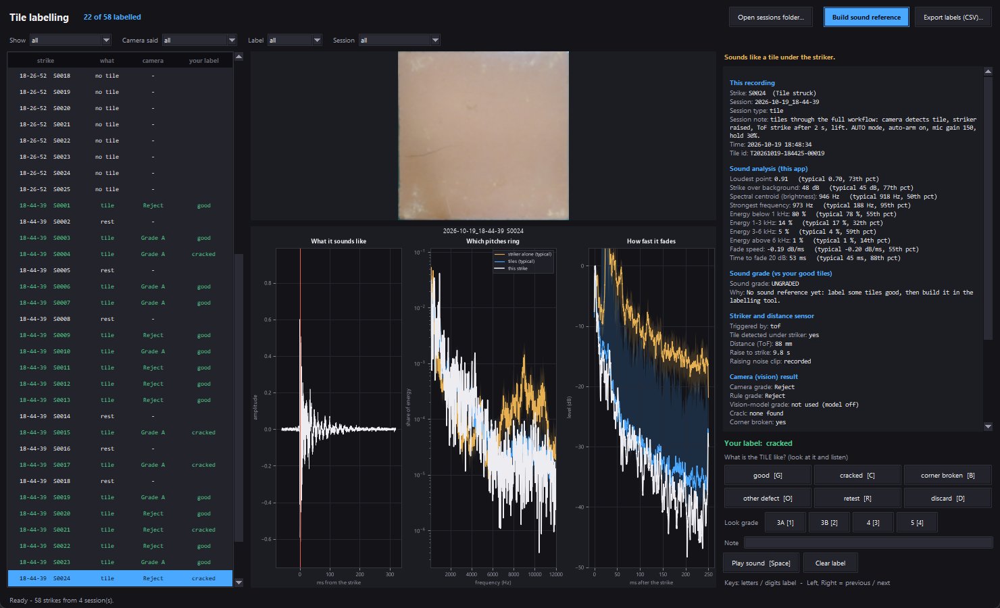

**Labelling tool, with the real labels.** The 58 strikes of the 2026-10-19 sessions, 22 labelled (green rows). Selected:
S0024, labelled cracked, with its tile picture, the camera's verdict (Reject, corner broken: yes), this app's sound
analysis and the three plots against the typical striker-alone (orange) and tile (blue) curves. The sound grade
reads UNGRADED because no sound reference was built in this run (a copy of the labels was used and nothing was saved
back).

## 4. Data used

| Session | What | Strikes |
|---|---|---|
| `2026-10-19_18-20-14` | 90 s room noise, striker resting | ambient only |
| `2026-10-19_18-26-52` | striker alone, coil powered, no tile | 25 retract + 25 strike clips |
| `2026-10-19_18-44-39` | tiles through the full workflow (camera, ToF strike after 2 s, lift), mic gain 150, hold 30 % | 28 strikes, **22 labelled: 17 good, 5 cracked** |

Labels are in `data/labels.json` (set by hand 2026-10-22). Tile identity beyond the label (which physical tile,
size, grade) is not recorded, so repeated strikes of one tile cannot be checked.

## 5. What a strike looks like

### 5.1 Waveforms


Room noise is about 0.0055 rms with only small blips. The striker alone gives a short click (peak 0.60 here) that is
over in a few ms. A tile strike rings for about 100 ms. Peak heights should not be compared between tiles: the cracked
example peaks at 0.91 and the good one at 0.53, but the striker's own peak varied 0.28-0.96 and the retract clips clip
at 1.0 at this gain.

### 5.2 Tile vs the striker alone


Averaged 5-250 ms after the strike, tile strikes sit about 5 dB above the striker alone around 300-500 Hz, 10-15 dB
above it from about 1 kHz to 3 kHz, and up to roughly 20 dB above it between 4 and 8 kHz, so the ring is real
signal, not striker rattle. Below about 250 Hz the curves meet, and around 9-10 kHz the striker's own peak reaches
the tile level, so those regions say little about the tile. Good and cracked average curves lie close together
everywhere (cracked slightly lower between 300 Hz and 1 kHz).


Energy falls about 30 dB in the first 100 ms for tiles. After about 200 ms tile and striker-only energy are within a
few dB, so a ring longer than 200 ms is not present in this data.


Power spectrum 300 ms after the strike, with the average of 25 striker-only strikes removed (bottom). The deep
spikes in the bottom plot are bins where the tile spectrum fell below the striker average; they are subtraction
artefacts, not real nulls.

## 6. Good vs cracked: before and after removing the striker


Example pair: good S0020 (left) and cracked S0024 (right). Top row: spectrograms as recorded. Middle row: the same
with the average striker-only spectrogram subtracted. Bottom: spectra, as recorded (left, with striker only in black)
and with the striker removed (right).

What the picture shows: the cracked example has a **faint steady line near 4.4 kHz** that lasts through the
300 ms window, and slightly more energy around 800-1000 Hz and 4-5 kHz. Removing the striker clears the click and the
low-frequency smear and makes the line easier to see.

What it does not show: that this is typical. It is one tile of each kind.

### 6.1 All labelled tiles


| Feature (5-300 ms after onset) | good mean (n=17) | cracked mean (n=5) |
|---|---|---|
| 100-500 Hz band, dB (relative) | -50.2 | -51.7 |
| 500-2000 Hz band, dB | -51.6 | -52.8 |
| 2000-8000 Hz band, dB | -56.2 | -56.8 |
| spectral centroid, Hz | 1264 | 1450 |

Dots overlap heavily; the cracked group is within the good group's spread on every feature.

### 6.2 Statistics (`tools/striker_subtraction.py`)

After subtracting the striker, cracked minus good (effect size d, permutation p from 20,000 shuffles):

| Feature | diff | d | p |
|---|---|---|---|
| total level | -0.1 dB | -0.08 | 0.872 |
| 100-500 Hz | -2.5 dB | -0.76 | 0.148 |
| 500-1000 Hz | -1.8 dB | -0.84 | 0.113 |
| 1000-2000 Hz | -1.9 dB | -0.61 | 0.243 |
| 2000-4000 Hz | -1.7 dB | -0.53 | 0.313 |
| 4000-8000 Hz | -1.6 dB | -0.41 | 0.429 |
| 8000-16000 Hz | -0.7 dB | -0.16 | 0.751 |
| centroid | +133 Hz | 0.33 | 0.523 |

Medium effect sizes in the low bands, but with 5 cracked tiles none is distinguishable from chance. Subtracting
the striker changed the values only slightly, so the striker was not what hid a difference.

### 6.3 Is the 4.4 kHz line a crack marker?


`tools/test_steady_peak.py` measures how far the 4.2-4.6 kHz band stands above its neighbours, 100-300 ms after the
strike. Good mean 7.57 dB, cracked mean 7.10 dB, AUC 0.49, p = 0.745: **no.** S0024 is the highest (11.9 dB) but
good S0023 (11.1) and S0003 (10.9) are close behind, so the line seen in section 6 is not specific to cracks. Scanning
every frequency gave a best AUC of 0.82 at 10.2 kHz, but with 114 bands tested and 5 cracked tiles a result that
good is expected by chance; 4.4 kHz ranks 50th of 114.

## 7. Method checks worth knowing

- A no-tile striker clip minus the mean of the other 24 leaves about -2.1 dB coherence: the striker is not
  perfectly repeatable, so subtraction is approximate.
- Median strike-to-lead-in SNR: 15.9 dB for no-tile, 22.2 dB for tile strikes.
- Energy per 50 ms after the strike (dB, good / cracked / striker only): `-18.4 -31.7 -37.6 -41.7 -45.1 -45.6` /
  `-19.5 -31.4 -38.1 -43.0 -46.8 -48.7` / `-26.7 -37.2 -41.8 -44.9 -46.4 -47.4`.

## 8. Limits and next steps

Not verified:

- **5 cracked tiles, 17 good**, from one session; no corner-broken or other defects. Any ranking above is weak.
- Which physical tile each strike was, tile size and grade tier are unknown, so tile-to-tile variation cannot be
  separated from crack effects.
- The first six tile strikes of the session (S0001-S0009) sit apart from the other 16 (higher centroid, no 20 dB fade
  in 250 ms); the cause (mic gain, tile or striker placement) has not been checked and they are included here.
- Levels are relative, not dB SPL (no pistonphone calibration), and Windows microphone enhancements were not
  confirmed off.
- Strike alignment in these scripts is a rough onset threshold, not the app's `strike_features`; `detect_impact`
  misfires on station clips (TODO).
- The grade (`strike_reference.py`) has never been built from enough real labels (needs at least 8 good tiles,
  17 are labelled now, and its leave-one-out result has not been reviewed). It can only say "different from the good
  tiles", not "cracked".

Next: record many more cracked and chipped tiles with identified tiles and repeated strikes of the same tile, calibrate
the microphone, find out why S0001-S0009 differ, then rebuild the reference and read its leave-one-out numbers.

## 9. Reproducing the figures

```powershell
venv\Scripts\python tools\make_screenshots.py       # app screens 1-7 and 10-21 (needs a visible desktop; 8-9 were captured earlier)
venv\Scripts\python tools\striker_subtraction.py    # figure 06 + section 6.2 numbers
venv\Scripts\python tools\compare_good_cracked.py   # figure 05 (before/after)
venv\Scripts\python tools\test_steady_peak.py       # figure 07 + section 6.3 numbers
venv\Scripts\python tools\make_report_figures.py    # figures 01-04 + section 6.1 numbers
```

The three comparison scripts write to `<Tile_Sorting>/data/` and the figures were copied from there into
`docs/report_figures/`. Session audio is in `<Tile_Sorting>/data/master/sessions/` and is not in git.
