# A Time-of-Flight-Triggered, Sprung-Solenoid Impact-Acoustic Station for Clay Tile Inspection: Design, Capture Pipeline and First Labelled Results

**Authors:** Mithunvel K. L. (23BMH1029; corresponding author, klm@smtw.in), Kanigalpula Teja Pavan Sai Adinarayana Gupta (23BMH1007), Madhumitha Vemula (23BMH1019)
**Affiliation:** School of Mechanical Engineering (Mechatronics and Automation), Vellore Institute of Technology, Chennai. Course BMEE497J / BMHA497J, Project 1.
**Guide:** Dr. Jegadeeshwaran R (50204)
**Emails of the second and third author, and any double-blind adjustments required by the target venue:** to be filled in by the team.

**Keywords:** impact acoustics; tile inspection; sensor-triggered capture; robust statistics; embedded striker control; multimodal grading; non-destructive testing

> **Status of this document.** Draft for the team's final review, prepared from the project's own data and code. Every number is traced to a file in the repository (listed in Section 9). Text that the college requires to be the team's own writing must be rewritten by the team before submission; the plagiarism limit of 10 % applies to the rewritten version. Items the template asks for that the project has not produced (for example, an improvement over a baseline) are reported as not achieved and are not invented.

---

## Abstract

Clay roofing tiles are still inspected, graded and sorted by hand in many small plants, and a crack invisible on the surface is exactly what a camera misses and a trained ear can catch. We built the sound-based part of an automated tile-grading line and tested it on real strikes. A sprung solenoid is released above the tile, an Arduino Nano sequences it, a time-of-flight sensor decides that a tile is present, and a USB microphone records continuously into a timestamped ring buffer. A Python pipeline cuts a 1.5 s clip around each strike, measures ten spectral and decay features, and grades the tile by its distance from tiles that a person labelled good. The aim was to test whether the sound separates cracked from good tiles well enough to add a vote to the camera grade. On 2026-10-19 the rig recorded 22 tile strikes and 25 striker-only strikes. The strike was found in all 22 labelled tile clips (31 to 50 dB over the background, median 45 dB), and the sensor separated tiles (81 to 97 mm) from the empty surface (145 to 176 mm) without overlap. The sound grade did not discriminate: against 17 good and 5 cracked tiles the leave-one-out reference accepted 12 of 17 good tiles and flagged 1 of 5 cracked ones, and no feature reached an area under the curve above 0.58 (permutation p of at least 0.29). Every non-GOOD verdict fell among the first six strikes of the session, which differ from the later 16 in spectral centroid (median 1,486 against 843 Hz) for an unexplained reason. The camera rules alone rejected 10 of the same 17 good tiles. The capture chain works; the sound grade is not yet usable for sorting.

---

## 1. Introduction

Fired clay tiles are a mass-produced building product whose value depends on two properties that are checked late and, in many plants, by eye: the surface appearance and the integrity of the body. A tile with a hairline crack may pass a visual check, survive handling and fail later in use. Plants grade tiles into quality tiers after firing, and in the plant this project is proposed for, Sree Murugan Tile Works, inspection, grading, sorting and packing are done manually. The project is part of a larger automated line that combines a camera, a tap-sound station, dimensional sensing and a Cartesian pick-and-place gantry. The tile size and weight range of the manufacturer's product line have not yet been obtained, so every dimension in the project documents is illustrative.

Present engineering practice for the visual side is mature. Machine-vision grading of ceramic tiles has been reported since the 1990s, with colour grading of plain and patterned tiles that graded sets of tiles correctly even when their differences were near the threshold of human perception (Boukouvalas et al., 1997), and recent reviews of deep learning for surface defects treat data scarcity, class imbalance and small defects as the main obstacles (Cumbajin et al., 2023; Wang et al., 2025). A camera sees the surface. It cannot see a crack that is closed or hidden, and it cannot see a change in the stiffness of the body. A stiffness change is what a tap measures: the struck body rings at frequencies set by its geometry, mass and elastic moduli, and a crack lowers local stiffness and adds damping, so that the ring becomes lower, shorter or less repeatable (Cawley & Adams, 1979). This idea is the basis of impulse-excitation testing of ceramics (ASTM International, 2022), of the egg industry's acoustic crack detectors (Coucke et al., 1997; De Ketelaere et al., 2000; Lin et al., 2009), and of laboratory studies on ceramic plates (Akinci, 2011; Nogay et al., 2022).

Making a tap-sound grade work on a moving line is a mechatronic problem, not only a signal-processing one. The sensing, computation and actuation chain has to place a repeatable strike on a tile whose position is only approximately known, detect that the tile is really there, capture the sound with the strike at a known place in the recording, reject the noise of the striker's own retraction, and deliver a verdict within the time budget of the line, all while a solenoid that heats when energised sits above a belt. Each of these has a measurable failure mode: a strike that is not recorded, a tile that is not detected, a clip in which the onset is misplaced, a verdict that depends on how the striker moved and not on how the tile rang.

The literature on tap-sound inspection is encouraging but thin in the respects that matter for a production line. Laboratory studies report very high accuracies on small samples (for example four ceramic plates in Nogay et al., 2022), tile studies concentrate on hollow-sounding installed tiles (debonding) and not on cracks in manufactured tiles (Limsupriyarat et al., 2018; Panyavaraporn et al., 2020), and the combination of a tap-sound grade with a camera grade, with explicit rules for what happens when the two disagree or when the sound is unusable, is not described in the sources we found. Practical questions remain open: how a striker made from commodity parts behaves, how the strike and the recording are paired reliably, and how much labelled data a distance-based grade needs.

The unresolved gap, in short, is a documented, reproducible chain from a physical strike to a graded tile, with an honest measurement of how well the resulting sound separates good from cracked tiles on real, labelled samples. Its practical consequence is that without such a measurement a plant cannot tell whether a sound station is worth building.

We therefore built the sound station and measured it. The work had one main aim and four testable hypotheses. The aim was to establish whether the sound of a tile struck by a sprung solenoid can be used to flag cracked tiles. The hypotheses were: **H1**, that the strike can be found in at least 95 % of recorded clips with a strike-over-background of at least 20 dB; **H2**, that the time-of-flight sensor separates a tile under the striker from the empty surface with no overlap about a single threshold; **H3**, that at least one sound feature separates cracked from good tiles with an area under the curve of 0.8 or more and a permutation p-value below 0.05; and **H4**, that a reference built from good tiles accepts at least 90 % of good tiles and flags at least 80 % of cracked ones.

The contributions of this paper are:

- **C1.** A striker, sensor and capture architecture in which the striker's timing lives on a microcontroller with a watchdog, the Pi only requests and arms, and every strike event carries a token that pairs it with exactly one recorded clip.
- **C2.** A transparent distance-based sound grade (median and scaled median absolute deviation of tiles labelled good, a worst-feature robust z-score, and an explicit RETEST and UNGRADED path) with a leave-one-out self-check.
- **C3.** A data-collection protocol that records continuous audio, video, every bus message and labelled strike events into a hash-sealed session folder, plus a labelling tool that shows each strike with its tile picture, the camera's verdict and the sound analysis.
- **C4.** A first measurement on 22 labelled real strikes, including a negative result on crack discrimination and the analysis of why: the sample is small, and six early strikes differ from the rest for an unexplained reason.

The remainder of the paper reviews related work (Section 2), states the gap and the validation metrics (Section 3), describes the architecture (Section 4) and the implementation (Section 5), the experiments (Section 6), the results (Section 7) and the conclusions (Section 8).

---

## 2. Related Work and Comparative Analysis

We organise the related work in four themes: acoustic and vibration testing of ceramics and tiles; tap-sound classification in other products; machine-vision grading and defect detection for tiles; and the statistical tools that a small-sample grade needs.

**Acoustic testing of ceramics.** The physical basis of vibration-based damage detection was set out by Cawley and Adams (1979), who showed that measuring a few natural frequencies at a single point can detect, locate and quantify damage when a finite-element model of the structure is available; their tests were on an aluminium plate and a carbon-fibre plate. Impulse excitation, in which a specimen is tapped and its resonant frequencies are read to derive moduli, is a standardised ceramic test for bars, rods and discs, and the standard itself notes that flat plates can be measured but that it gives no equations for them (ASTM International, 2022). The plate equations are in Leissa (1969). A tile is a thin plate, so its flexural modes scale with thickness over the square of the side, which is why the tile size matters for every threshold. For concrete, the impact-echo method uses a mechanical point impact and the reflections of stress waves to find internal flaws (Sansalone & Carino, 1986). For ceramic plates specifically, Akinci (2011) used impact noise from a plastic-tipped hammer with time-frequency analysis to separate sound plates from cracked ones, and Nogay et al. (2022) trained a pre-trained convolutional network on noise curves produced by an impact pendulum, reporting 99.50 % accuracy on a data set built from four plates (three with invisible cracks and one undamaged).

**Tap-sound classification in other products and in installed tiles.** The egg industry is the best-developed analogue because the product is a thin brittle shell and the line speed is high. De Ketelaere et al. (2000) tapped eggs at points around the equator and found a repeatable frequency pattern for intact eggs and irregular patterns for cracked ones, with a reported detection level near 90 % and fewer than 0.5 % false rejects. Lin et al. (2009) compared k-nearest neighbours, a neural network and a support vector machine on five features of the response and reported identification rates of 95.1 % (calibration) and 97.1 % (prediction) for the support vector machine, and Sun et al. (2013) described an on-line version. For installed tiles, tapping is used to find hollow (debonded) tiles: Limsupriyarat et al. (2018) classified dull and hollow sounds from the frequency spectrum, with accuracy up to 98.73 %, and Panyavaraporn et al. (2020) used discrete-wavelet and mel-frequency cepstral features (Davis & Mermelstein, 1980) with a convolutional network for 93.67 %. Percussion sound with a CNN has also been applied to concrete cracks (Ge et al., 2025). All of these report laboratory-scale results and none of them attaches a sound verdict to a camera verdict on the same tile.

**Machine-vision grading.** Boukouvalas et al. (1997) graded the colour of ceramic tiles by machine vision. A recent systematic review of convolutional networks for surface defects screened 253 records and kept 59 studies, grouped by surface type including ceramics (Cumbajin et al., 2023), and a 2025 review of deep learning for ceramic surface defects covers data preparation and the imbalanced-sample problem (Wang et al., 2025). The project's own camera station follows this line: a rule-based crack and corner check with an optional ONNX grade classifier (a convolutional network and a vision transformer, Dosovitskiy et al., 2021). These sources show that vision is strong on surface defects and weak where the defect is not visible; they do not tell us how a sound verdict should be combined with it. Surveys of multimodal learning treat that combination as a fusion problem with representation, alignment and fusion stages (Baltrušaitis et al., 2019), but they are not specific to tiles.

**Statistical tools for small samples.** A grade built from few labelled tiles needs a robust spread estimate and an honest self-test. Using the median absolute deviation instead of the standard deviation protects a reference from outliers (Leys et al., 2013), and its scaled form has a known efficiency (Rousseeuw & Croux, 1993). The sample-size effects on error estimation in pattern recognition are well documented (Raudys & Jain, 1991), the area under an ROC curve equals the Wilcoxon statistic (Hanley & McNeil, 1982), exact permutation p-values should include the observed value (Phipson & Smyth, 2010), many tests on one data set need a correction (Benjamini & Hochberg, 1995), and proportions from small counts need interval estimates such as Wilson's (Wilson, 1927).

**Comparison.** Table 1 compares the sources on the criteria that matter for this project. The common weaknesses are small or unreported sample sizes, laboratory conditions, and the absence of an evaluation against a camera baseline.

**Hardware and software trade-offs in the existing solutions.** The rigs in these studies share one feature: a controlled impactor (a pendulum, a plastic-tipped hammer, an eggshell tapping rig) so that the input is repeatable and the sound carries the information. They differ in what they leave unsaid. A pendulum or a hand-held hammer is accurate in a laboratory but does not say how the instant of impact is tied to the recording on a moving line; deep models trained on a handful of plates trade engineering effort for data that the plant does not have; and a method that needs a finite-element model of every product (Cawley & Adams, 1979) adds a modelling cost for each new tile size. Cost, synchronisation between the strike and the recording, drift of the microphone and the striker over a shift, and the effort to deploy and re-calibrate are rarely reported, and the field validation that would show them is missing. A commodity striker with an event-based capture and a transparent, abstaining grade is a different point in this trade-off space: it gives up model power in exchange for an auditable chain.

| # | Prior study | Methodology | Hardware / platform | Reported metric | Limitation (from the source) | Implication for this work |
|---|---|---|---|---|---|---|
| 1 | Cawley & Adams (1979) | Natural-frequency shifts, finite-element model | Aluminium and CFRP plates | Damage located and quantified | Needs a model of the structure | A tile's frequencies need its dimensions, not yet known |
| 2 | Akinci (2011) | Impact noise, time-frequency analysis | Plastic-tipped hammer, ceramic plates | Sound vs cracked separated | Sample size not retrieved | Time-frequency view is worth adding |
| 3 | Nogay et al. (2022) | Pre-trained CNN on noise curves | Impact pendulum | 99.50 % accuracy | Four plates (three cracked, one intact) | Cannot be generalised; we need many tiles |
| 4 | De Ketelaere et al. (2000) | Resonance frequency pattern of tapped eggs | Eggs on a tapping rig | About 90 % detection, under 0.5 % false rejects | Egg-specific | Repeatability across tap positions is the key quantity |
| 5 | Lin et al. (2009) | kNN, ANN, SVM on 5 response features | Acoustic resonance system | 95.1 % / 97.1 % (SVM) | Sample count not stated on the page | Classifier choice matters less than clean features |
| 6 | Limsupriyarat et al. (2018) | FFT of tapping audio | Hand-tapped lab tiles | Up to 98.73 % | Hollow (debonded) tiles, not cracks | Different defect |
| 7 | Panyavaraporn et al. (2020) | DWT + MFCC + CNN | Tapping sound of tiles | Up to 93.67 % | Hollow tiles, laboratory | Different defect |
| 8 | Ge et al. (2025) | MFCC + CNN with SE attention | Percussion sound on concrete | Better than ResNet18, RF, LSTM in their comparison | Concrete, not ceramic | Deep models need far more data than we have |
| 9 | Boukouvalas et al. (1997) | Colour grading | Machine vision | Matched graders near perception threshold | Colour only | Camera is complementary |
| 10 | Cumbajin et al. (2023); Wang et al. (2025) | Reviews of CNN defect detection | Various | 59 studies screened; imbalance and scarcity emphasised | Reviews, not systems | Small labelled sets are the norm |

*Table 1. Prior studies compared on method, platform, metric and limitation (limitations are those stated in or visible from the source; sample sizes are as retrieved).*

The weaknesses that motivate this study are therefore (a) that tap results come from small laboratory samples that cannot say how a station behaves on a production run, (b) that crack detection on manufactured tiles is not directly addressed by the tile-tapping work, which targets debonding, and (c) that no source we found combines a tap verdict with a camera verdict and defines what happens when the sound is unusable. These are limitations of what we found in a limited search and not a claim about the whole literature.

---

## 3. Research Gap, Objectives and Novelty

The shortcoming that remains unsolved is the absence of a reproducible, instrumented chain from a physical strike on a manufactured tile to a graded tile, evaluated on real labelled samples against the camera alone. Published tap-sound studies report high accuracy on small laboratory samples but leave open how the striker is built and sequenced, how the strike is guaranteed to be in the recording, what the system does when the sound is weak or the tile missing, and how much labelled data a grade needs.

**Main objective.** To build and characterise a sound station for clay tiles on commodity parts and to determine, with real labelled strikes, whether its sound features can flag cracked tiles.

**Specific, measurable objectives.**

1. O1: record every strike with the strike inside a known window of the clip (onset found in at least 95 % of clips, strike-over-background of at least 20 dB).
2. O2: detect the tile under the striker with a single distance threshold that separates tile and empty readings without overlap.
3. O3: grade a tile by robust distance from tiles labelled good, and measure its false-alarm and catch rates by leave-one-out.
4. O4: compare the sound grade with the camera's own grade on the same tiles.

**How the mechanism differs from the baselines.** Four differences are explicit. First, the strike timing is owned by the microcontroller, which sequences raise, countdown, strike and lift, enforces a watchdog and refuses to lower the striker onto a tile; the Pi only requests and arms, so a slow Pi or a lost message cannot change a strike. Second, capture is triggered by the striker's own event and not by the sound level, so the retraction noise, the lift noise and handling sounds cannot start a capture, and each event's token follows it into the finished clip so that a clip is paired with exactly its own event (this replaced an arrival-order pairing in which one refused tap shifted every later pairing). Third, the grade is a transparent distance with named reasons and an explicit UNGRADED state, so that the station abstains until labelled good tiles exist. Fourth, the data are recorded as a hash-sealed session that can be re-cut and re-labelled without re-collecting.

**Scope and the limits of the novelty.** None of these is a new signal-processing algorithm: the features are standard, the robust distance is textbook, and the components are commodity (a microcontroller, a distance sensor, a solenoid and a USB microphone). The novelty claimed is in integration and in method: the ownership of timing, the token pairing, the abstention rules and the reproducible protocol. We make no claim of a better classifier than published ones.

**Why a measured negative result is still a contribution.** A sound station that has never been measured against labelled tiles invites a decision to build it, buy it or drop it on belief. Stating in advance what would count as success (the hypotheses H1 to H4 and their thresholds) and then reporting that H3 and H4 were not met turns the prototype into evidence: it tells the plant that the capture chain is ready and that the grade needs data it does not yet have, and it tells the next team where the weak points are (the sample, the early strikes, the labels). The claims we do not make are equally explicit: we do not claim that tile sound cannot detect cracks, only that this rig, this reference and these 22 labelled tiles did not show it, and we do not claim that the camera grade is better, only that on the same tiles it also did not separate the classes.

**Evaluation hypotheses and success criteria.** The hypotheses H1 to H4 stated in Section 1 define success. They are tested in Section 7. The table below maps each gap to its mechanism and validation metric.

| Research gap | Proposed mechanism | Validation metric | Success criterion |
|---|---|---|---|
| Strike not reliably in the recording | Hardware-event trigger with token pairing; 0.5 s pre-roll | Onset found; strike-over-background (dB) | 95 % of clips; at least 20 dB (H1) |
| Tile presence not verified | ToF distance at the strike, 100 mm threshold | Tile vs empty distance ranges (mm) | No overlap (H2) |
| Crack discrimination on manufactured tiles unproven | Spectral and decay features | AUC, permutation p per feature | AUC at least 0.8, p below 0.05 (H3) |
| Grade not checked against labels | Robust z reference with leave-one-out | Good accepted, cracked flagged (counts, Wilson 95 % CI) | 90 % and 80 % (H4) |
| No comparison with the camera | Same labelled tiles, camera rule grade | Good rejected, cracked rejected | Report only |

---

## 4. Proposed System Architecture

The station strikes a tile once, records the sound together with the instant of the strike, extracts features of the ring, compares them with a reference of good tiles and returns a verdict that the fusion layer combines with the camera's grade. The inputs are a tile arriving under the striker, a distance reading, the microphone stream and the camera's grade of the tile; the outputs are a strike, a recorded clip and a sound verdict; the environment is a laboratory bench with a hand-turned belt, a green belt mat and room noise of about 0.0055 RMS (full scale 1.0) at the microphone gain used. Figure 1 shows the architecture, with each arrow numbered and described in its key.

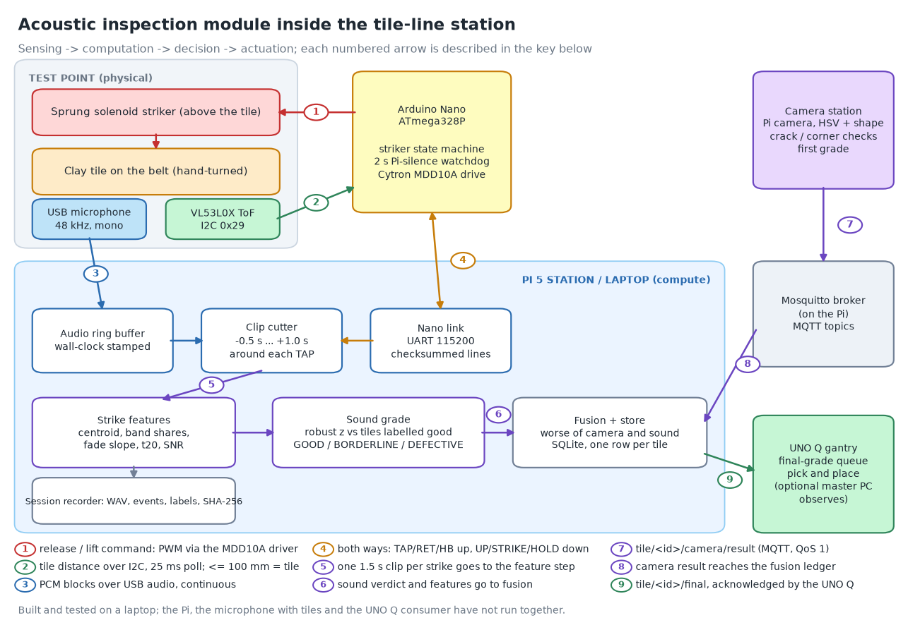

*Figure 1. Architecture of the acoustic inspection module. Numbered arrows are described in the key under the figure.*

**Sensing and acquisition.** The physical test point holds the striker above the tile, a time-of-flight distance sensor that reports the distance to the tile or the surface, and a USB microphone. The Arduino Nano (ATmega328P) polls the sensor every 25 ms and requires five consecutive readings of 100 mm or less (about 125 ms) before it treats a tile as present. The microphone is read continuously at 48 kHz, mono, 16 bit into a ring buffer whose blocks carry the wall-clock time of the audio device, so that any instant can be cut out afterwards. A sprung solenoid is energised to lift the striker and released to strike, by gravity and spring, so a strike is the event of releasing the coil.

**Control and information flow.** The Nano owns the striker sequence of Figure 2: resting down with the coil off, raised when a tile is expected, a 2 s countdown after the sensor recognises the tile, the strike, a lift 1.5 s later so that the tile can leave, and a quiet lowering to rest after 3 s of nothing to do. The Pi sends requests (UP, arm or disarm, hold power) and the Nano reports events (TAP at the release, RET at the lift, a heartbeat) over a checksummed serial protocol at 115200 baud. If no valid line arrives for 2 s the Nano disarms itself and lowers the striker, it never lowers onto a tile, and a manual hold longer than 8 s is released as a safety strike so that the coil does not overheat.

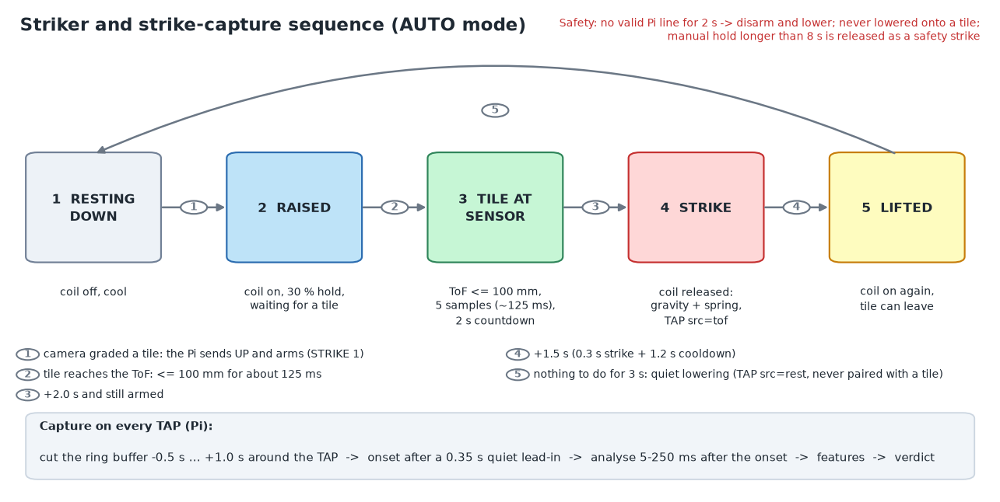

*Figure 2. Striker states and transitions with their timings, and the capture that follows every TAP.*

**Decision layer.** On every TAP the Pi cuts a clip from the ring buffer (0.5 s before the event to 1.0 s after), finds the strike onset after a quiet lead-in, extracts features from 5 to 250 ms after the onset, and compares them with the reference. The verdict is one of GOOD, BORDERLINE, DEFECTIVE, RETEST (no strike or too weak), UNGRADED (no reference yet) or NO TILE (the sensor saw no tile). The fusion layer then combines the camera's grade and the sound verdict as the worse of the two, but the sound counts only if it is enabled, valid, graded and confident; by default it does not vote.

**Communication, synchronisation, feedback and failure.** Stations talk through an MQTT broker (OASIS, 2014) on the Pi; the camera publishes a result per tile, the fusion ledger binds a tap to the oldest waiting tile, and the final grade is sent to the pick-and-place controller with acknowledgements and retries. The Pi serves network time (Mills et al., 2010), but the other machines have not yet been pointed at it, and the recorded streams are expected to agree only to tens of milliseconds, which has not been measured. Failure responses are explicit: a missing microphone is a reported fault and not an exit, a dropped capture is reported and still uses the tile's slot with the camera grade alone, and an unrecognised strike is a RETEST.

**How the modules address the gap.** The microcontroller removes the dependence on the Pi's timing, the event trigger removes the retraction noise from the capture, the token removes the arrival-order ambiguity, and the abstaining grade makes the station safe to run before it is calibrated. Compared with a simpler baseline in which the microphone alone triggers on loudness and every clip is graded, the added components cost a microcontroller and a distance sensor and remove three failure modes that we had observed or could reason about from the sequence: the retract noise being graded as a tile, a refused tap shifting the pairing, and a strike with no tile under it being graded as a tile.

**Timing budget and throughput.** The microphone block rate is set by the audio device at 48 kHz (a sample every 20.8 microseconds), which is far finer than anything the grade uses. The slow steps are in the sequence: the sensor needs about 125 ms to confirm a tile, the countdown adds 2.0 s, the strike-to-lift interval adds 1.5 s, and the clip cutter waits for 1.0 s of audio after the strike before it can cut. A tile therefore occupies the strike point for at least 3.5 s, which bounds the throughput of this station to roughly one tile per 3.5 s (about 17 per minute) before any other limit of the line, and the earliest possible verdict is about 1 s after the strike plus the processing time. These are derived from the configured timings and not measured; the processing latency from the TAP to the verdict, and the latency of the serial and audio paths, have not been measured on the rig. For a plant that needs more than about 17 tiles per minute per station, the countdown would be shortened or several stations used.

Table 2 lists each module with its input, output and purpose.

| Module | Input | Output | Purpose | Measurable contribution |
|---|---|---|---|---|
| Tile sensor (VL53L0X) | Distance (mm) | Tile / no tile | Prevent striking an empty belt; label strikes | Tile 81–97 mm vs empty 145–176 mm (Section 7) |
| Nano striker state machine | Distance, Pi requests | Strike (TAP), lift (RET), heartbeat | Own the timing; enforce safety | Strike-to-retract interval known from the Nano's clock |
| Audio ring buffer | PCM blocks | Time-stamped audio | Allow a clip to be cut at any event | 0 dropped blocks in the 2026-10-19 tile session |
| Clip cutter | TAP event, ring | 1.5 s WAV | Pair each strike with its sound | Strike onset 0.47–0.57 s into the clip |
| Strike features | Clip | Ten features | Describe the ring | SNR 31–50 dB, onset found 22 of 22 |
| Sound grade | Features, reference | Verdict with reasons | Flag tiles unlike good ones | 12 of 17 good accepted; 1 of 5 cracked flagged |
| Fusion | Camera and sound results | Final grade | Combine the two | Sound does not vote by default |

*Table 2. Modules, their inputs and outputs, and what each contributes.*

---

## 5. Materials, Methods and Implementation

### 5.1 Prototype specification and physical design

The prototype is a bench rig. The belt is turned by hand, with no motor, so belt speed does not appear in any result. A single sprung solenoid is mounted above the tile; the striker mass, spring constant and drop height have not been measured. The camera is upstream of the striker and grades the tile on a trigger line; the tile then travels to the striker. Figure 4 shows the camera station's view of a belt and the pipeline's overlays, and Figure 5 a frame from the session video. A wiring drawing of the sprung striker is not included; its pin assignments are in Table 3.

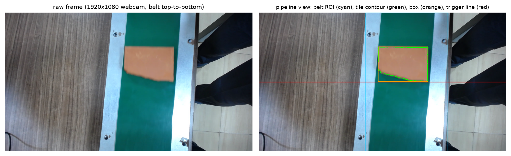

*Figure 4. Camera station: raw frame (left) and pipeline view (right) with belt region of interest (cyan), tile contour (green), box (orange) and trigger line (red). The footage is from an earlier recording than the tap session.*

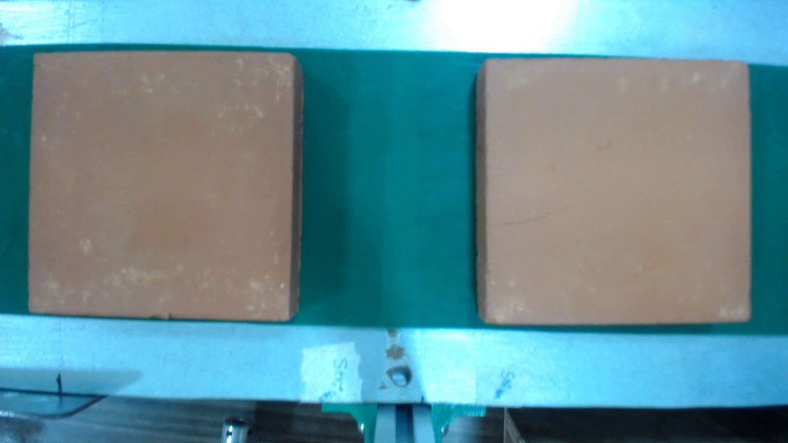

*Figure 5. A frame from the 2026-10-19 session video, about 8 s before strike S0024. Two tiles are in view, so the frame is not tied to a single strike.*

### 5.2 Hardware and selection rationale

Table 3 lists the hardware. Values that the project files do not record (supply voltages, solenoid coil data) are marked as such and must be taken from the datasheets by the team.

| Component | Key specification (recorded in project files) | Selection justification | Functional role | Expected effect |
|---|---|---|---|---|
| Arduino Nano (ATmega328P, CH340 USB) | Firmware compiled for AVR: 17,308 B flash, 1,397 B RAM (68 %); 115200 baud serial | Cheap, hard real-time timing in a microcontroller | Striker state machine, watchdog | Strike timing independent of the Pi |
| Cytron MDD10A driver | PWM on D10, DIR on D8 (held high); Timer1 at about 31 kHz | A motor driver switches the coil with PWM hold | Pull-in at 100 % for 150 ms, then hold power (default 30 %) | PWM above audible range so the coil does not hum into the microphone |
| Sprung solenoid | Energised = up, released = gravity + spring; mass, spring, height unmeasured; coil overheated when held up at 60 % | Simple, no ball or lock | Impact source | Repeatable strike, to be characterised |
| VL53L0X time-of-flight | I2C at 0x29 on A4/A5; tile threshold 100 mm; measured tile 81–97 mm, empty 145–176 mm | Contactless, small, answers on I2C | Tile-present decision | Prevents empty strikes |
| USB microphone ("USB PnP Audio Device") | 48 kHz, mono, 16 bit; gain 150 in the session note; Windows enhancements must be off | Low cost, recorded continuously | Sound capture | Relative levels only (no calibration) |
| Raspberry Pi 5 (16 GB) | Runs the acoustic and camera services, MQTT broker | Enough compute for continuous audio and a camera | Station decision computer | Final grade computed on the Pi |
| Camera | 1920 × 1080 frames; HSV segmentation, belt region, trigger line | Needed for the first grade and for tile identity | Tile detection and grade | Provides the baseline for comparison |

*Table 3. Hardware components, specifications recorded in the project files, and their roles.*

The distance threshold of 100 mm was chosen from measurement, and the empty-surface readings in the 2026-10-19 no-tile session (145 to 176 mm) are higher than the 112 to 149 mm recorded in earlier notes; the difference has not been explained and may be a mounting or surface change.

### 5.3 Software and algorithms

Table 4 lists the software with versions and the reason for each choice. The analysis code is in the Acoustic-Analysis repository (v0.4) and the station code in the Tile_Sorting repository.

| Software / algorithm | Version / parameters | Reason for selection | Function | Outcome metric |
|---|---|---|---|---|
| Python | 3.13.7 | Used throughout the project | All analysis and tooling | Reproducible scripts |
| NumPy, SciPy, Matplotlib | 2.5.3, 1.18.1, 3.11.1 (Harris et al., 2020; Virtanen et al., 2020; Hunter, 2007) | Standard scientific stack | Arrays, filters, spectra, plots | Test suite of 360 tests |
| Welch spectrum, Hann window | Segment min(4096, N) samples (Welch, 1967; Harris, 1978) | Low-variance spectrum from a short ring | Ring spectrum | Centroid and band shares |
| Butterworth band-pass + Hilbert envelope | 4th order, 300–12,000 Hz, zero-phase | Fade of the ring in dB (the app's Analyze screen also offers a Schroeder backward-integrated decay curve, Schroeder, 1965, not used here) | Decay slope, t20 | Fade features |
| Robust reference | Median, 1.4826 × MAD, spread floor 5 % of the median (Leys et al., 2013; Rousseeuw & Croux, 1993) | Resistant to an odd good tile | Reference of good tiles | z-scores |
| Grade thresholds | z_ok = 3, z_bad = 6, min good = 8, min SNR 20 dB | Provisional guesses | GOOD / BORDERLINE / DEFECTIVE | Leave-one-out counts |
| pyserial, sounddevice, arduino-cli | 3.5, 0.5.6, current | Serial link, audio, flashing | Hardware I/O | Flash and link tested |
| Mosquitto / paho (MQTT 3.1.1) | OASIS (2014) | Standard publish-subscribe | Station messaging | Tile-keyed messages |

*Table 4. Software, versions, parameters and outcome metrics.*

### 5.4 Model and assumptions

A struck thin plate rings at frequencies f_mn = (λ_mn² / (2π a²)) · √(D / (ρ h)) with flexural rigidity D = E h³ / (12 (1 − ν²)) (Leissa, 1969), where *a* is the side, *h* the thickness, *ρ* the density, *E* Young's modulus, *ν* Poisson's ratio and λ_mn a mode constant that depends on the boundary conditions. A crack lowers the stiffness locally and adds damping, so modes shift down and decay faster (Cawley & Adams, 1979). We did not compute tile frequencies, because the tile size and material constants are unknown and the boundary condition (a tile resting on a belt mat) is not simply supported; the equation is used only to say which direction a crack should move a feature.

The measurements are defined as follows. The clip x(t) has onset t₀, the first sample after the lead-in whose magnitude exceeds 8 times the lead-in RMS σ_lead (lead-in 0.35 s):

(1) SNR = 20 · log₁₀( max |x(t)| over t ∈ [t₀, t₀ + 50 ms] / σ_lead )

The ring window is [t₀ + 5 ms, t₀ + 250 ms]. Its Welch power spectral density, restricted to 100–12,000 Hz and normalised so that Σ p_k = 1, gives

(2) c = Σ f_k p_k (spectral centroid),  F_b = Σ_{f_k ∈ b} p_k (band share, with edges at 1, 3 and 6 kHz giving F_low, F_mid, F_high, F_top).

The envelope e(t) is the Hilbert magnitude of the band-passed signal, smoothed over 2 ms and expressed in dB. The fade slope s is the least-squares slope of e(t) over 3 to 120 ms, and t20 is the time after the 5 ms reference at which e falls 20 dB, reported as missing if it does not within the window:

(3) s = d e / d t (dB/ms),  t20 = min { t : e(t) ≤ e(5 ms) − 20 dB }.

The reference holds for each feature j the median m_j and a scaled spread σ_j over the good tiles, and a new strike is scored by its worst feature:

(4) σ_j = max( 1.4826 · MAD_j , 0.05 |m_j| , 10⁻⁹ ),  z_j = (x_j − m_j) / σ_j,  z* = max_j |z_j|,

with GOOD for z* ≤ 3, BORDERLINE for z* ≤ 6 and DEFECTIVE above, RETEST when the strike is under 20 dB over the background, and UNGRADED when fewer than eight good tiles exist. For evaluation, the separation of a feature between cracked (c) and good (g) tiles is the area under the ROC curve (Hanley & McNeil, 1982) and a permutation p-value with B = 20,000 shuffles that counts the observed statistic as one permutation (Phipson & Smyth, 2010):

(5) AUC = P(x_c > x_g) + ½ P(x_c = x_g),  p = (1 + #{ |Δ*| ≥ |Δ_obs| }) / (B + 1).

Assumptions: the strike is repeatable enough that the striker's own sound does not vary more than the tile's; the ring window is long enough to contain the ring but short enough to exclude the striker's second bounce; a labelled tile is correctly labelled. None of these has been verified on the real rig beyond what Section 7 reports.

### 5.5 Data acquisition and pipeline

Figure 3 shows the workflow. A session folder holds the continuous microphone in 30 s WAV chunks with the wall-clock start of each chunk, the camera's raw video with a per-frame time log, every bus message, and a table of labelled striker events, plus one derived WAV clip per event and a SHA-256 manifest. The raw streams are never edited; clips and labels are derived and can be regenerated. Each retract and each strike is a separate event with a source (`tof` for a tile-triggered cycle, `manual`, `safety`, `tof_blind`, or `rest`), and only `tof` strikes are paired with a camera tile. The labelling tool shows every strike with the tile picture, the camera and model verdicts, the analysis plots, and buttons for good, cracked, corner broken, other defect and a grade tier.

The firmware core is portable C++ behind a hardware abstraction, so that the same state machine is compiled for the Nano and, on a laptop, against a simulated board; the host tests drive it over the real protocol module. Serial lines are checksummed, the Nano announces itself with a HELLO line and sends a heartbeat that carries the mode, the retracted flag, the sensor distance, the armed flag, the state and the time left in it, and any refused command answers with a coded error (not in manual mode, inhibited, busy, not retracted, fault). The emergency-stop input is a normally-closed loop read with the internal pull-up, so a cut wire reads as a stop, and a trip latches a fault with the coil off until it is reset. The pull-in is 100 % duty for 150 ms to lift the striker, after which a lower hold duty keeps it up; if the hold duty is too low the striker drops by itself, which is an unreported strike, so the screen warns next to the hold slider.

In the recording of the tile session the microphone produced 14,300,640 samples in ten 30 s chunks (about 297.9 s) with no dropped audio blocks, and the camera's raw video carries a wall-clock time for every frame, so that a strike can be located in the video. The labels follow a fixed taxonomy (good, cracked, corner broken, other defect, plus the grade tiers 3A, 3B, 4 and 5 for the look of the tile); the tool also lets the labeller mark a strike as retest or discard. The sound reference is built from tiles labelled good only: for each of six features it stores the median and the scaled spread of Equation 4, and a self-check grades every good tile against a reference built without it and every cracked tile against the full reference, which is the leave-one-out result reported in Section 7.

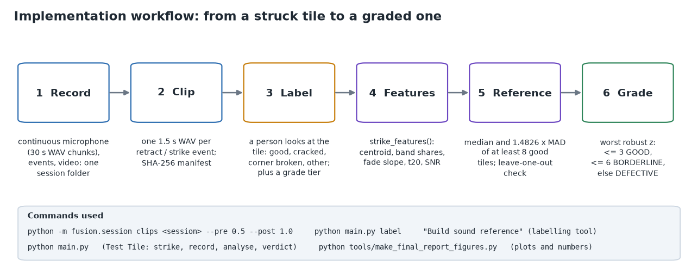

*Figure 3. From a struck tile to a graded one: record, clip, label, features, reference, grade.*

### 5.6 Integration and repeatable procedure

1. Flash the Nano from the app (`python main.py flash`; it tries the 115200 and 57600 bootloaders) and confirm the heartbeat and the tile-sensor reading.
2. Start a data session with the microphone, the camera and the Nano, set the run type (ambient, no tile, tile) and note the microphone gain and hold power.
3. Record the room (striker resting), then the striker alone (manual cycles with no tile), then tiles.
4. Cut clips (`python -m fusion.session clips <session> --pre 0.5 --post 1.0`) and open the labelling tool (`python main.py label`).
5. Label each strike by looking at the tile and listening to it, then press *Build sound reference* once at least eight tiles are labelled good, and read the leave-one-out result before trusting a verdict.

### 5.7 Real-time constraints, calibration, safety and error handling

The timing parameters are: sensor poll 25 ms, debounce 5 samples, release delay 2,000 ms after recognition, lift 1,500 ms after the strike, rest delay 3,000 ms, heartbeat 250 ms, Pi-silence watchdog 2,000 ms, pull-in 150 ms at full power and hold power 30 %. The microphone is uncalibrated, so levels are relative and not in dB SPL. The coil heats when energised for long; the first design rested the striker up and the coil overheated, so the striker now rests down, is armed only while a tile is in the system and lowers itself when idle; the coil temperature at the chosen hold power has not been measured. The emergency-stop input latches a fault with the coil off. These safety behaviours were verified in simulation against the firmware core and on the bench to the extent recorded in the project notes (the striker was parked up, held, released manually and on a tile, and lifted again); the camera-triggered arming and the lowering to rest have not been seen on the rig with the coil powered.

---

## 6. Experimental Setup and Validation

**Objective and testable claims.** The experiments tested H1 to H4 of Section 1 on recordings made on 2026-10-19 and labelled on 2026-10-22: that the strike can be found and is strong (H1), that the distance sensor separates tile from surface (H2), that some sound feature separates cracked from good tiles (H3), and that a reference of good tiles accepts good and flags cracked tiles (H4). We also compared the sound grade with the camera's own grade on the same tiles.

**Setup and instruments.** The rig of Section 5 was used with the microphone gain set to 150 (as recorded in the session note), the striker hold power at 30 % and the belt turned by hand. Figure 6 shows the two kinds of tile photographed by the camera and Figures 7 to 10 show the application screens used to run and analyse the tests. The reference measurement for the labels is a person's look at the tile photograph and the sound.

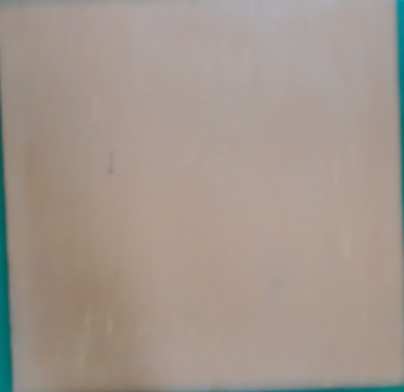 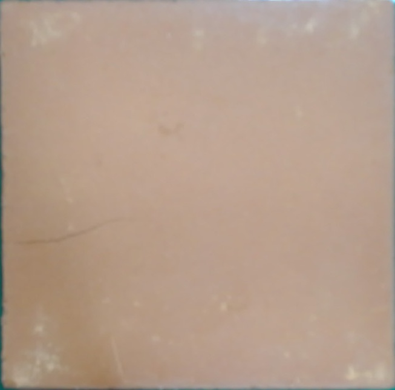

*Figure 6. Camera pictures of tile strike S0020 (labelled good, left, blurred by motion) and S0024 (labelled cracked, right; a thin dark line crosses the lower part of the tile).*

*Figure 7. Test Tile screen: connect the Nano and the microphone, strike, and read the verdict with the waveform, the spectrum and the fade. Shown with a fake Nano and clips from earlier sessions; the verdicts come from a throwaway reference.*

*Figure 8. Labelling tool on the 58 strikes of the 2026-10-19 sessions, 22 labelled (green rows). Selected: S0024, labelled cracked, with its photo, the camera's verdict and the sound analysis.*

|  | 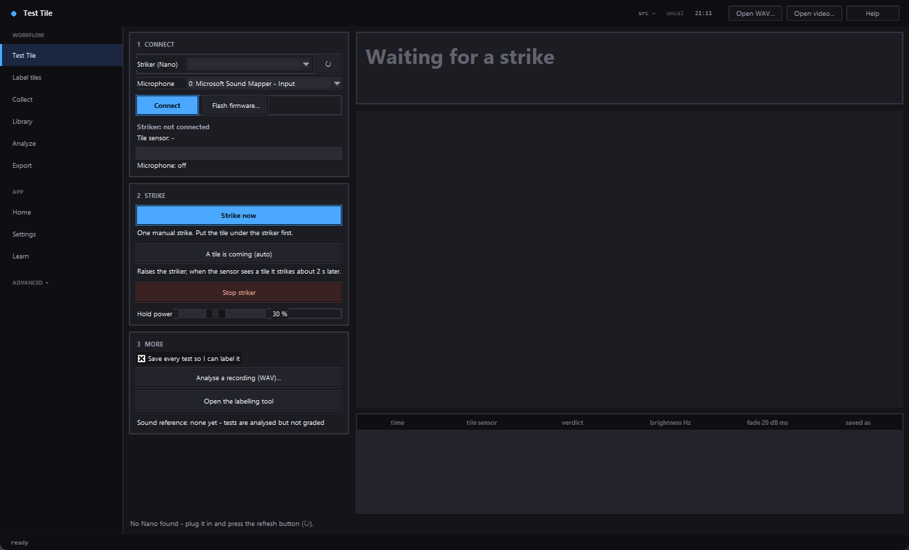 |
|---|---|
| *Figure 9a. Collect: setup (records the motor and the striker alone so they can be subtracted).* | *Figure 9b. Collect: listening with the live level and adaptive trigger.* |
|  |  |
| *Figure 9c. Collect: review, as recorded against cleaned.* | *Figure 9d. Analyze: waveform, spectrum, third-octave shape, energy decay and features.* |

*Figures 9a to 9d were captured on synthetic demonstration data (the real microphone and tiles were not connected).*

**Ground truth and its weakness.** The reference for a tile's class is a person looking at the camera's picture of the tile and listening to the strike. This is the best reference available on the project, but it is weak in three ways: the picture is a motion-blurred crop (Figure 6, left), a hairline crack may not show in it, and a person listening may be influenced by what they see. A labelled-cracked tile is therefore a tile that looked or sounded cracked to one person, and the five cracked tiles should be read that way. A better reference would be a controlled mechanical test of each tile, or labels by two people with an agreement measure, and both are listed under future work.

**Test conditions and protocol.** Three sessions were used (Table 5): 90 s of room noise with the striker resting; the striker alone, with 25 manual retract-and-release cycles 6 s apart and no tile; and tiles passed through the full workflow (camera grades the tile, the Pi arms and raises the striker, the sensor recognises the tile and the strike follows 2 s later). The independent variable was the tile (good or cracked, as labelled); the dependent variables were the sound features, the onset and the sensor reading. The tiles were fed by hand. Labels were assigned afterwards in the labelling tool by one person, in about two minutes for 22 labels according to the time stamps in `labels.json`; there was no second rater and no recorded physical re-inspection.

| Scenario | Controlled variables | Baseline | Repetitions | Metric |
|---|---|---|---|---|
| Room noise, striker resting | Gain 150 | Not applicable | 90 s | RMS |
| Striker alone, manual cycles | Gain 150, no tile, 6 s spacing | Not applicable | 25 strikes | Onset, spectrum, ToF distance |
| Tiles, full workflow | Gain 150, hold 30 %, 2 s release delay | Always-GOOD; camera rule grade | 22 tile strikes (6 more were quiet lowerings to rest), all 22 labelled (17 good, 5 cracked) | Onset, SNR, features, AUC, p, counts |

*Table 5. Test scenarios, controlled variables, baselines, repetitions and metrics.*

The sessions were recorded on 2026-10-19: room noise at 18:20 for 90 s with the striker resting; a one-cycle check at 18:26; 25 manual no-tile cycles starting at 18:26:52, 6 s apart; and the tile run at 18:44 lasting about 298 s, in which the camera graded each tile, the Pi armed and raised the striker, and the sensor released the strike 2 s after it recognised the tile. The session note for the tile run records automatic mode, auto-arm on, microphone gain 150 and hold power 30 %. The independent variable of interest is the label; the confounding variables that were not controlled are the order of the tiles, their size and thickness, the position of the tile under the striker, and any change of microphone placement during the run.

**Baselines, repetitions and ablation.** The trivial baseline is to call every tile good (it accepts all good tiles and catches no cracked tile). The second baseline is the camera's rule grade on the same 22 tiles. The ablation is the sound grade with and without the first six strikes of the session. Each strike has its own camera tile identifier, but whether a physical tile was struck more than once is not recorded, so the repeatability of a single tile has not been measured; the striker-alone strikes (n = 25) give the repeatability of the striker.

**Metrics, statistics and acceptance criteria.** Onset found (count), strike-over-background (Equation 1), the ten features, AUC and permutation p per feature (Equation 5), good tiles accepted and cracked tiles flagged with Wilson 95 % intervals (Wilson, 1927), and the criteria of H1 to H4. With eight features tested, a Benjamini–Hochberg correction (Benjamini & Hochberg, 1995) would be applied to any p-value claimed as significant; none reached 0.05 uncorrected. With so few cracked tiles (5) the results are exploratory and the intervals are wide.

**Threats to validity.** The sample is small (17 good and 5 cracked), so the area under the curve of any feature has a wide interval and a single tile can move it by 0.1 or more; the classes are unbalanced (17 to 5), which favours the always-good baseline when accuracy is quoted, which is why we report counts per class; the first six strikes differ from the rest, so the session is not homogeneous; many features were tested on the same data, which raises the chance of a spurious finding and is the reason the 10.2 kHz scan result is not claimed; the labels come from one person in about two minutes; and a single rig and a single day cannot show how the station behaves over a shift or across tile batches. We therefore treat every positive-looking observation as a hypothesis for the next data set.

**Calibration, uncertainty, reproducibility and safety.** There was no acoustic calibration, so no level is in dB SPL. The microphone's Windows enhancements were required to be off, which the notes record as a rule and not as a verified fact for this session. The data, the labels and every script are in the repositories, and the figures are regenerated by `tools/make_final_report_figures.py`, `tools/make_report_diagrams.py` and the comparison scripts. The experiments used no human participants. The coil had overheated earlier when held up for long, which is why the striker now rests down.

---

## 7. Results and Discussion

**Recap and organisation.** The results are given by objective: the capture chain (O1, O2), the sound features (O3) and the comparison with the camera (O4). All numbers come from `docs/final_report_figures/numbers.json`, produced by the script named above from the sessions of 2026-10-19 and the labels of 2026-10-22.

### 7.1 Capture chain (H1 and H2)

The strike was found in all 22 labelled tile clips (22 of 22; Wilson 95 % interval 85 to 100 %) and in all 25 striker-only clips. The strike-over-background (Equation 1) ranged from 31.0 to 50.5 dB with a median of 45.3 dB, so H1 (at least 95 % found, at least 20 dB) was met. The room noise was about 0.0055 RMS at gain 150 (first 1.5 s of the first chunk). The logbook records striker-alone strike peaks of 0.28 to 0.96 of full scale and retract clips that reached full scale (clipped), so levels are close to clipping at this gain.

The onset sat 0.473 to 0.536 s into the 1.5 s tile clips (median 0.483 s) and 0.478 to 0.574 s in the striker-only clips (median 0.534 s), against the expected 0.5 s (Figure 11, right). The tile and no-tile onsets differ by about 50 ms in the median. Because the onset is detected by a threshold, a stronger tile strike crosses it earlier, which is a plausible but untested explanation; the spread of about 0.1 s is a measurement of how loosely the clip is aligned to the strike, and shows that a fixed window cannot be assumed.

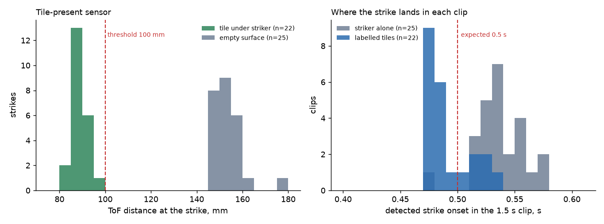

*Figure 11. Left: ToF distance at the strike for tile strikes (n = 22) and striker-only strikes (n = 25), with the 100 mm threshold. Right: detected strike onset in the clip.*

The tile sensor read 81 to 97 mm (median 88 mm) with a tile and 145 to 176 mm (median 151 mm) on the empty surface, so a single 100 mm threshold separated all 47 readings with no overlap (H2 met in this data). The margin to the threshold is 3 mm on the tile side, which is small: one tile at 97 mm is close to the limit, and a thicker or tilted tile could cross it. The interval from raising the striker (retract) to the strike was 1.5 s (1,500 to 1,501 ms) in the 25 manual cycles, and between 2.0 and 16.6 s (median 7.2 s) in the tile cycles, because in the tile cycles the striker waits raised for the tile.

### 7.2 What the sound of a strike looks like

The striker alone gives a short click of a few milliseconds; a tile strike rings for about 100 ms (Figure 12). Averaged over 5 to 250 ms after the strike, the tile is about 5 dB above the striker alone near 300 to 500 Hz, 10 to 15 dB above it between 1 and 3 kHz, and up to roughly 20 dB above it between 4 and 8 kHz (Figure 13), so the ring is real signal. After about 200 ms the tile and the striker-only energies are within a few dB (Figure 14), so a long ring is not present in this data.

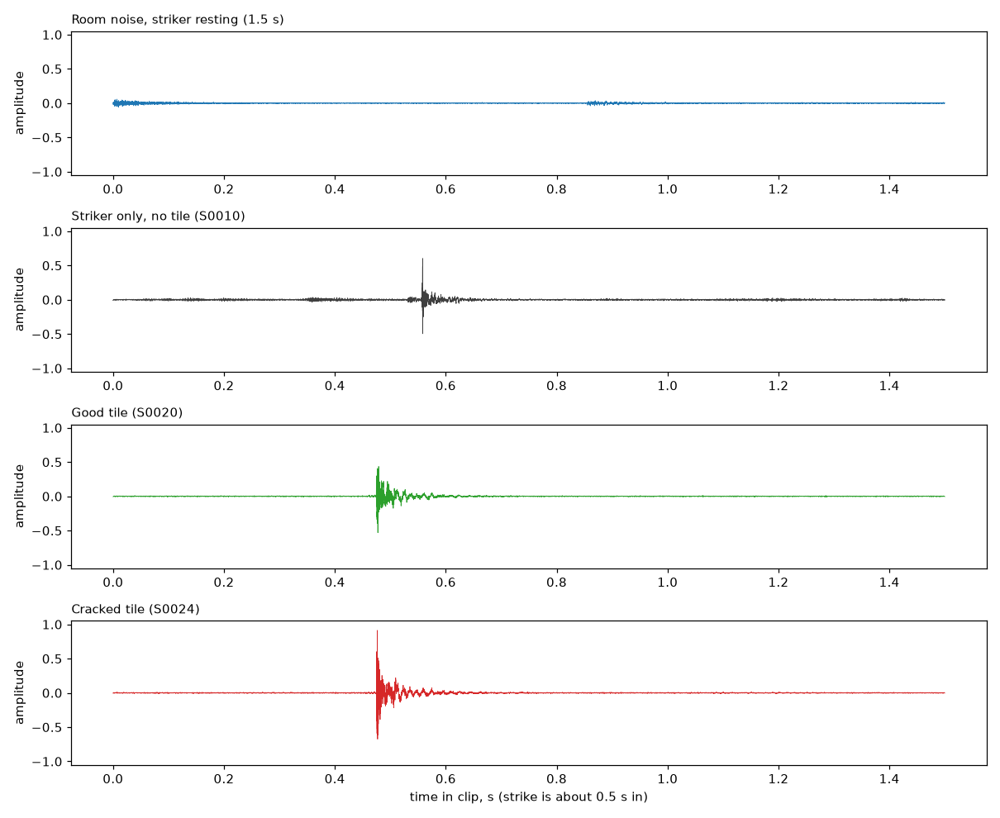

*Figure 12. Room noise, striker alone, a good tile (S0020) and a cracked tile (S0024) at gain 150.*

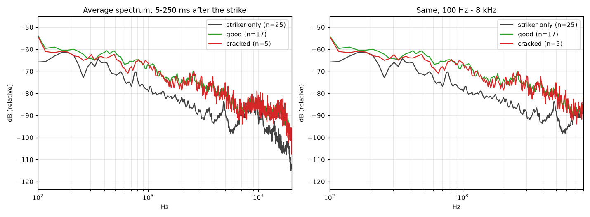

*Figure 13. Average spectrum 5–250 ms after the strike: striker only (n = 25), good (n = 17), cracked (n = 5).*

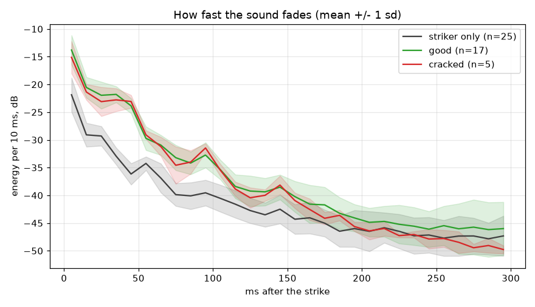

*Figure 14. Energy per 10 ms after the strike (mean ± 1 s.d.).*

### 7.3 Do the features separate cracked from good tiles? (H3)

They did not. The medians of the good and cracked tiles are close on every feature (Table 7), the area under the curve of every feature lay between 0.39 and 0.58, and the smallest permutation p-value was 0.29 (Figure 15). H3 (AUC of at least 0.8 with p below 0.05) was not met, and no multiple-comparison correction is needed because nothing was nominally significant. An earlier analysis of band energies after subtracting the average striker-only spectrum found medium effect sizes in the low bands (standardised effect sizes d of −0.4 to −0.8, cracked quieter by 1.6 to 2.5 dB) but permutation p-values of 0.11 and above, which is the same conclusion.

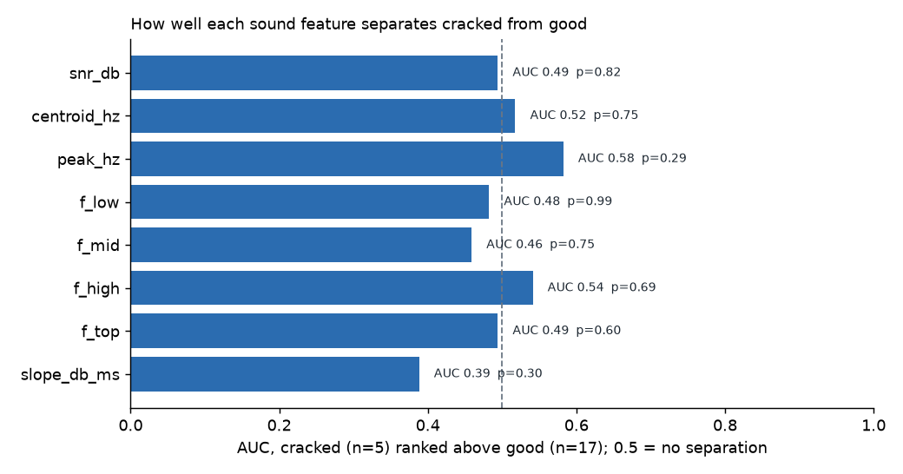

*Figure 15. AUC of each feature for ranking cracked tiles above good ones (0.5 = no separation), with the permutation p-value.*

| Feature | Good median (n = 17) | Cracked median (n = 5) | AUC | Permutation p |
|---|---|---|---|---|
| Spectral centroid (Hz) | 890 | 946 | 0.52 | 0.75 |
| Strongest frequency (Hz) | 188 | 305 | 0.58 | 0.29 |
| Energy below 1 kHz (share) | 0.776 | 0.796 | 0.48 | 0.99 |
| Energy 1–3 kHz | 0.170 | 0.152 | 0.46 | 0.75 |
| Energy 3–6 kHz | 0.042 | 0.054 | 0.54 | 0.69 |
| Energy above 6 kHz | 0.014 | 0.013 | 0.49 | 0.60 |
| Fade slope (dB/ms) | −0.194 | −0.198 | 0.39 | 0.30 |
| Strike over background (dB) | 45.9 | 43.3 | 0.49 | 0.82 |

*Table 7. Features of the 22 labelled tile strikes.*

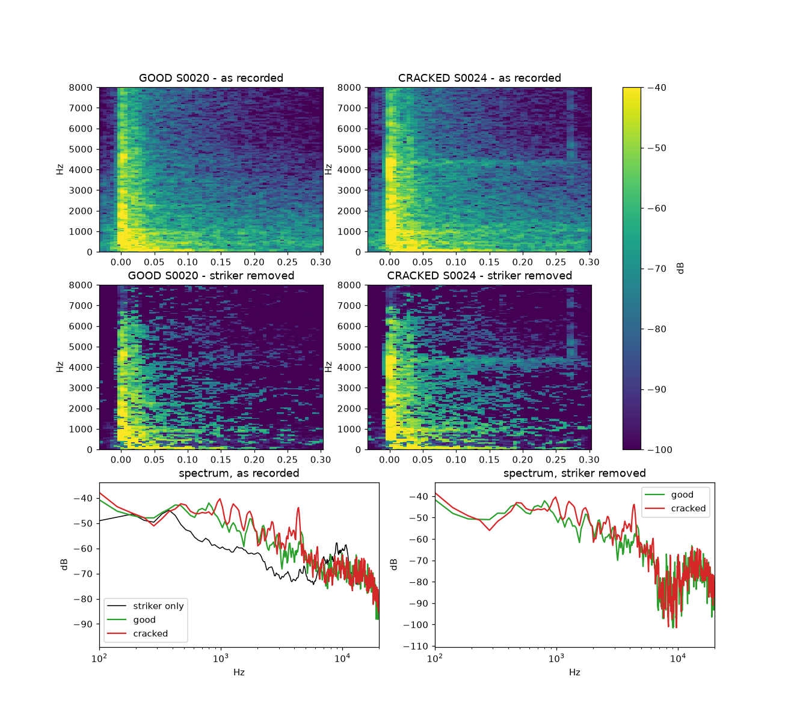

*Figure 16. One good (S0020) and one cracked (S0024) tile, spectrograms and spectra as recorded and with the striker-only average removed.*

The pair of tiles in Figure 16 shows a faint steady line near 4.4 kHz for the cracked example. A direct test across all labelled tiles gave a mean prominence of 7.57 dB for good and 7.10 dB for cracked (AUC 0.49, p = 0.745) and ranked 4.4 kHz 50th of 114 band centres, so the line in one tile is not a marker of cracks (Figure 17). The most separating band in a scan (10.2 kHz, AUC 0.82) is what one expects by chance from 114 tests on five cracked tiles.

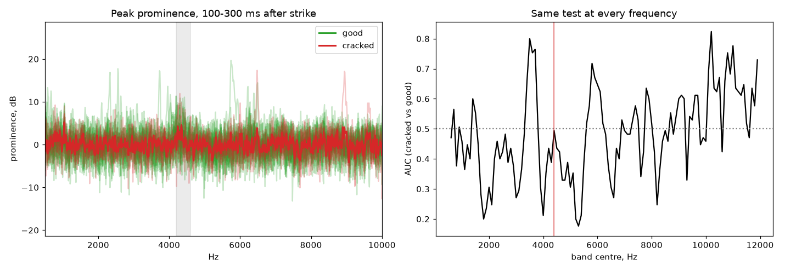

*Figure 17. Prominence of the 4.2–4.6 kHz band 100–300 ms after the strike for each tile (left) and the same statistic scanned over frequency (right).*

### 7.4 The reference grade and the first six strikes (H4)

The leave-one-out reference accepted 12 of 17 good tiles (70.6 %, Wilson 95 % interval 46.9 to 86.7 %) and rejected 5 (4 borderline, 1 defective); it flagged 1 of 5 cracked tiles (20.0 %, interval 3.6 to 62.4 %). H4 (90 % and 80 %) was not met. The distribution of the worst z-score is in Figure 18.

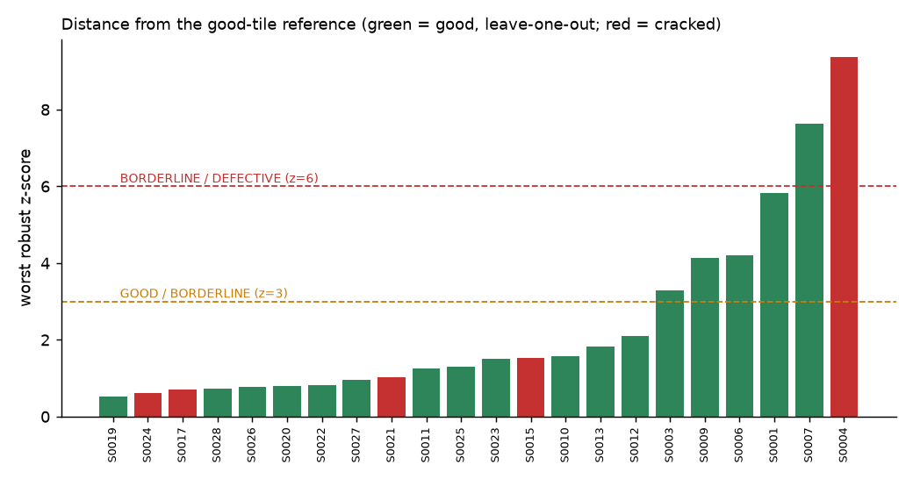

*Figure 18. Worst z-score of each labelled tile against the good-tile reference (leave-one-out for good tiles).*

The pattern in Figure 18 is more informative than the counts. The one cracked tile that was flagged (S0004, z = 9.4) and the five good tiles that were not accepted (S0001, S0003, S0006, S0007, S0009) are exactly the first six tile strikes of the session. The other 16 strikes (12 good and 4 cracked) all had a worst z of at most 2.09, so the reference accepted all 16: it caught none of the 4 cracked tiles and rejected none of the 12 good ones. The early strikes differ from the later ones (Figure 19): median centroid 1,486 against 843 Hz, energy below 1 kHz 0.565 against 0.811, energy above 6 kHz 0.037 against 0.012, and in 5 of the 6 the ring did not fade 20 dB within the window whereas in all 16 later strikes it did (median 45 ms). The cause is not established. It may be microphone gain, the position of the tile or the striker, or the order in which the first tiles were handled, and the session note does not say. Because the six also contain one cracked tile, the only crack the reference caught is confounded with whatever made the early strikes different.

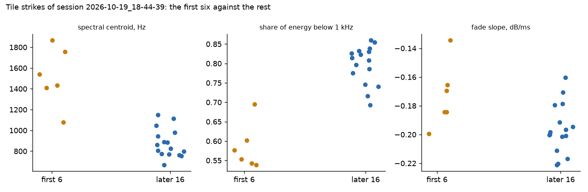

*Figure 19. Spectral centroid, energy below 1 kHz and fade slope for the first six tile strikes and the later 16.*

### 7.5 Comparison with the camera baseline (O4)

Table 6 compares the grades on the same 22 tiles. The camera's rule grade rejected 12 of 22 tiles: 10 of the 17 good tiles and 2 of the 5 cracked ones; every one of the 12 carried a broken-corner flag with a corner fill ratio between 0.89 and 0.97, which looks like a false flag on intact corners and is unvalidated. The sound reference was gentler on good tiles and weaker on cracked ones. Combining the two as the worse of both, which the station does only if the sound vote is enabled, would flag 13 of 17 good tiles and 3 of 5 cracked ones. These counts are too small for the intervals to separate the methods.

| Performance metric | Baseline: always GOOD | Baseline: camera rule grade | Proposed: sound reference | Worse of camera and sound | Units | Trials |
|---|---|---|---|---|---|---|
| Good tiles accepted | 17 of 17 | 7 of 17 (41 %; 22–64 %) | 12 of 17 (71 %; 47–87 %) | 4 of 17 (24 %; 10–47 %) | tiles | 17 |
| Cracked tiles flagged | 0 of 5 | 2 of 5 (40 %; 12–77 %) | 1 of 5 (20 %; 4–62 %) | 3 of 5 (60 %; 23–88 %) | tiles | 5 |
| Strike found | not applicable | not applicable | 22 of 22 (100 %; 85–100 %) | not applicable | clips | 22 |
| Tile-sensor separation | not applicable | not applicable | no overlap (81–97 vs 145–176) | not applicable | mm | 47 |
| Improvement over baseline | | | One more cracked tile flagged than always-GOOD, at five false alarms; not a demonstrated improvement | | | |

*Table 6. Performance on the 22 labelled tiles (Wilson 95 % intervals in brackets).*

### 7.6 Discussion, limitations and implications

**Why the capture chain worked and the grade did not.** The capture chain is a timing and signal-to-noise problem and it was solved by design: the event trigger, the pre-roll and the quiet lead-in gave a strike in every clip at a strike-over-background of at least 31 dB. The grade is a classification problem and it depends on information the data cannot yet supply: 5 cracked tiles, no record of which physical tile was struck, a possibly heterogeneous set of tiles, and an unexplained shift between the first six strikes and the rest. A reference built from 17 good tiles, five of which are among the six atypical early strikes, has an inflated spread for exactly the features that matter, which makes later tiles look normal; this is consistent with the later 16 all being accepted, but it is not proven. Small samples distort error estimates in either direction (Raudys & Jain, 1991), so no figure in this section is a performance claim. For the same reason we did not try the trained classifiers that the literature favours, such as support vector machines (Cortes & Vapnik, 1995; used by Lin et al., 2009) or random forests (Breiman, 2001): with five cracked tiles they would fit the sample and not the tiles.

**Robustness and sensitivity.** The sensor margin of 3 mm to the threshold, the 0.1 s spread of the onset and the near-clipping peak at gain 150 are the three sensitivities visible in the data. The camera baseline's high false-reject rate on good tiles shows that the project's other grade is also not yet reliable, so a fused verdict inherits false alarms from both.

**Limitations.** One session, one rig, one labeller, no physical tile identity, no repeated strikes of one known tile, a hand-turned belt, no acoustic calibration, no coil temperature, no repeatability of one tile, and no test of the camera-triggered arming on the powered rig. The published studies we compared with (Table 1) are not directly comparable: they differ in product, defect and sample.

**Deployment implications.** The station is ready as a data-collection instrument and not as a sorting instrument. The sound grade should stay disabled as a vote (its default), and a reference should not be built before the first-six anomaly is explained.

**Objectives met.** O1 and O2 (and H1, H2) were met; O3 and O4 (and H3, H4) were not met, in the sense that the grade was built and measured and did not reach the criteria.

---

## 8. Conclusion and Future Work

We set out to establish whether the sound of a clay tile struck by a sprung solenoid can flag cracked tiles. We built a striker, a distance-sensor trigger, a timestamped capture chain and a transparent distance-based grade, and measured them on 22 tile strikes and 25 striker-only strikes. The capture chain worked: the strike was found in 22 of 22 labelled clips at a median 45 dB over the background, and the sensor separated tiles from the surface without overlap. The sound grade did not discriminate: the reference accepted 12 of 17 good tiles and flagged 1 of 5 cracked ones, no feature reached an AUC above 0.58, and the camera's rule grade on the same tiles rejected 10 of the 17 good ones. All non-GOOD verdicts fell in the first six strikes, which differ from the rest for an unknown reason. The objectives on capture were accomplished; the objective on crack discrimination was not, and the sound grade is not ready for sorting. The next steps are to find the cause of the first-six difference, to record many more cracked and chipped tiles with physical tile identities and repeated strikes of the same tile, and to calibrate the microphone and measure the striker's repeatability and coil temperature. With those data the reference can be rebuilt and the leave-one-out result read again.

---

## 9. Data, Code and Traceability

| Item | Location |
|---|---|
| Sessions (audio, video, events, clips, tile pictures) | `Tile_Sorting/data/master/sessions/2026-10-19_*` (not in git) |
| Labels | `Acoustic-Analysis/data/labels.json` |
| Numbers quoted in this paper | `Acoustic-Analysis/docs/final_report_figures/numbers.json` |
| Figures 1–3, 11, 15, 18, 19 | `tools/make_report_diagrams.py`, `tools/make_final_report_figures.py` |
| Figures 12–14, 16, 17 and the effect sizes quoted in Section 7.3 | `tools/make_report_figures.py`, `tools/striker_subtraction.py`, `tools/compare_good_cracked.py`, `tools/test_steady_peak.py` |
| Application screens | `tools/make_screenshots.py`; all screens are in `docs/ACOUSTIC_REPORT.md` |
| Station behaviour and protocol | `documents/programming/striker_sequence.md`, `nano_serial_protocol.md`, `data_collection_sessions.md` (Tile_Sorting) |

**Not verified in this paper:** the Pi, the real microphone with tiles on the Pi, the UNO Q consumer of the final grade, the camera-triggered arming on the powered rig, the coil temperature, the alignment of the streams to better than tens of milliseconds, and any result on tiles of the manufacturer's actual sizes.

---

## Appendix A. Further application screens

The remaining screens of the application, captured on synthetic demonstration data, are shown for completeness; Monitor and Record are idle because no microphone was connected.

| | |
|---|---|
|  *Home.* | 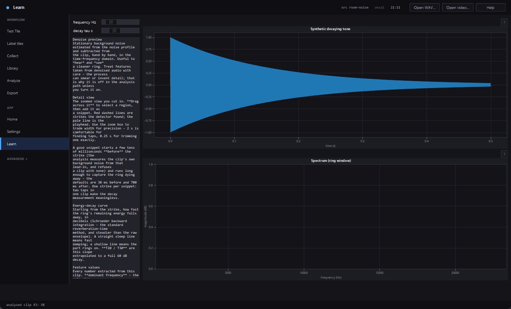 *Learn.* |
| 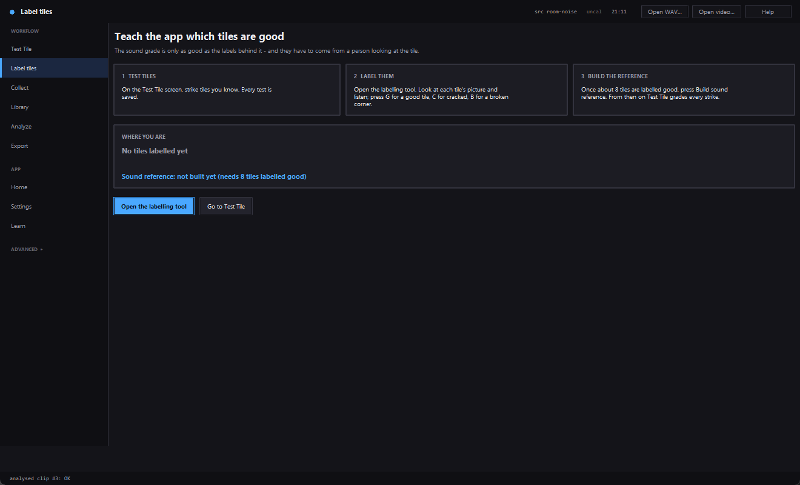 *Label tiles hub.* |  *Compare (good vs cracked demo clips).* |
|  *Filters.* | 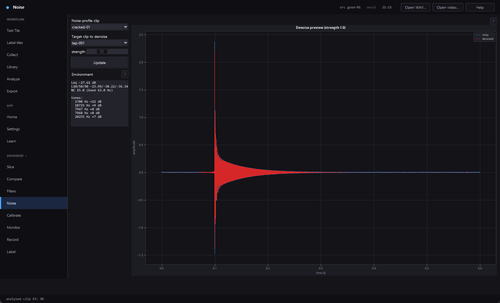 *Noise.* |
|  *Label.* |  *Calibrate (synthetic 1 kHz tone, not applied).* |
|  *Library.* |  *Export.* |
|  *Slice (generated test video).* |  *Settings.* |
|  *Monitor (idle).* |  *Record (idle).* |

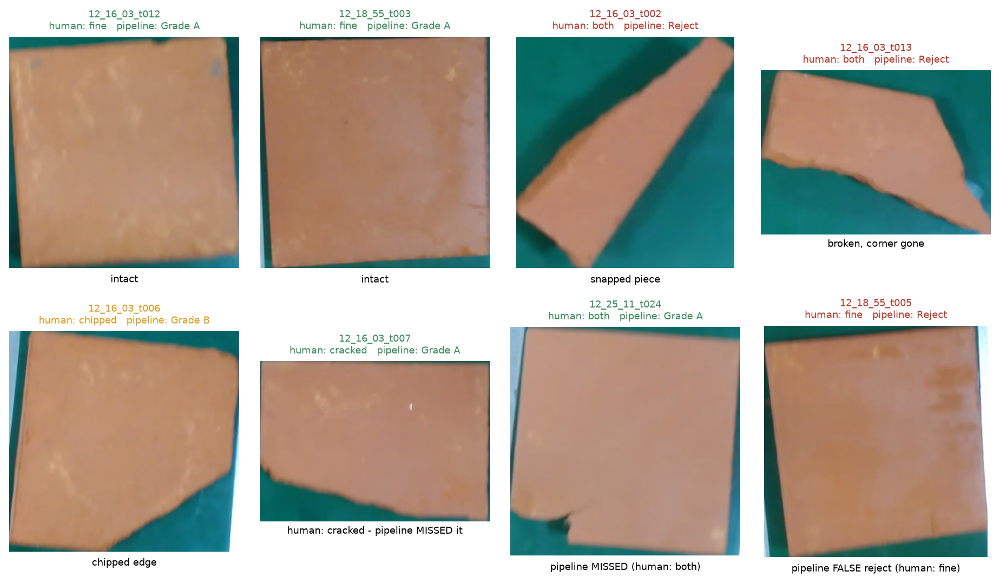

*Camera station: a gallery of belt tiles with the owner's labels against the pipeline's grade (from the second review). It shows intact tiles, snapped and chipped tiles, and the pipeline's misses and false rejects.*

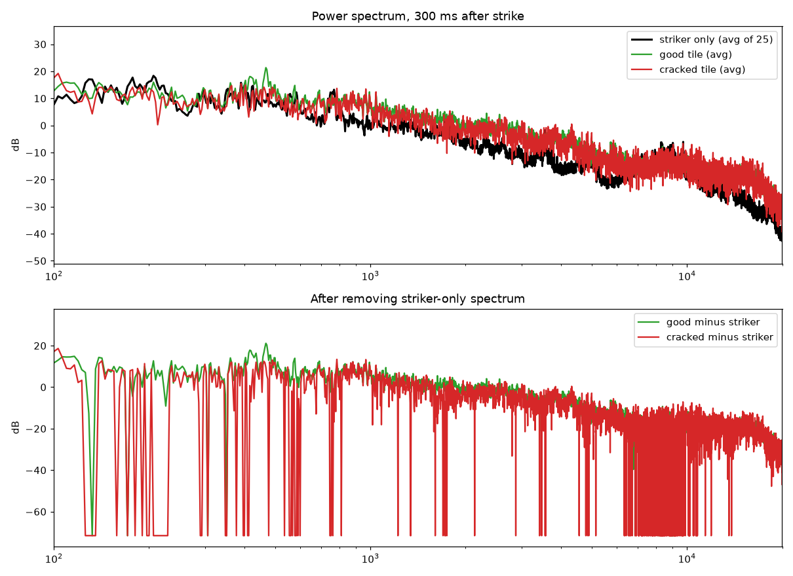

*Power spectrum 300 ms after the strike with the average of 25 striker-only strikes removed (bottom).*

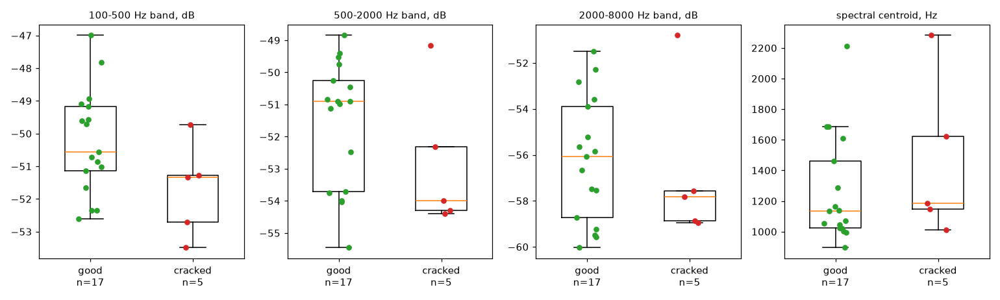

*Band levels and centroid of every labelled tile, good against cracked.*

---

## References

Akinci, T. C. (2011). The defect detection in ceramic materials based on time-frequency analysis by using the method of impulse noise. *Archives of Acoustics, 36*(1), 77–85. https://doi.org/10.2478/v10168-011-0007-y

ASTM International. (2022). *Standard test method for dynamic Young's modulus, shear modulus, and Poisson's ratio by impulse excitation of vibration* (ASTM E1876-22). ASTM International.

Baltrušaitis, T., Ahuja, C., & Morency, L.-P. (2019). Multimodal machine learning: A survey and taxonomy. *IEEE Transactions on Pattern Analysis and Machine Intelligence, 41*(2), 423–443. https://doi.org/10.1109/TPAMI.2018.2798607

Benjamini, Y., & Hochberg, Y. (1995). Controlling the false discovery rate: A practical and powerful approach to multiple testing. *Journal of the Royal Statistical Society: Series B, 57*(1), 289–300. https://doi.org/10.1111/j.2517-6161.1995.tb02031.x

Boukouvalas, C., Kittler, J., Marik, R., & Petrou, M. (1997). Automatic color grading of ceramic tiles using machine vision. *IEEE Transactions on Industrial Electronics, 44*(1), 132–135. https://doi.org/10.1109/41.557508

Breiman, L. (2001). Random forests. *Machine Learning, 45*(1), 5–32. https://doi.org/10.1023/A:1010933404324

Cawley, P., & Adams, R. D. (1979). The location of defects in structures from measurements of natural frequencies. *Journal of Strain Analysis for Engineering Design, 14*(2), 49–57. https://doi.org/10.1243/03093247V142049

Cortes, C., & Vapnik, V. (1995). Support-vector networks. *Machine Learning, 20*(3), 273–297. https://doi.org/10.1007/BF00994018

Coucke, P., De Ketelaere, B., & De Baerdemaeker, J. (1997). Detection of eggshell cracks by means of acoustic frequency analysis. *IFAC Proceedings Volumes, 30*(26), 163–168. https://doi.org/10.1016/S1474-6670(17)41264-X

Cumbajin, E., Rodrigues, N., Costa, P., Miragaia, R., Frazão, L., Costa, N., Fernández-Caballero, A., Carneiro, J., Buruberri, L. H., & Pereira, A. (2023). A systematic review on deep learning with CNNs applied to surface defect detection. *Journal of Imaging, 9*(10), 193. https://doi.org/10.3390/jimaging9100193

Davis, S. B., & Mermelstein, P. (1980). Comparison of parametric representations for monosyllabic word recognition in continuously spoken sentences. *IEEE Transactions on Acoustics, Speech, and Signal Processing, 28*(4), 357–366.

De Ketelaere, B., Coucke, P., & De Baerdemaeker, J. (2000). Eggshell crack detection based on acoustic resonance frequency analysis. *Journal of Agricultural Engineering Research, 76*(2), 157–163. https://doi.org/10.1006/jaer.2000.0542

Dosovitskiy, A., Beyer, L., Kolesnikov, A., Weissenborn, D., Zhai, X., Unterthiner, T., Dehghani, M., Minderer, M., Heigold, G., Gelly, S., Uszkoreit, J., & Houlsby, N. (2021). An image is worth 16x16 words: Transformers for image recognition at scale. *International Conference on Learning Representations (ICLR 2021)*. https://arxiv.org/abs/2010.11929

Ge, C., Qin, Y., Xie, K., & Lu, Z. (2025). Fast and intelligent detection of concrete cracks based on sound signals and convolutional neural network. *Frontiers in Built Environment, 11*, Article 1627643. https://doi.org/10.3389/fbuil.2025.1627643

Hanley, J. A., & McNeil, B. J. (1982). The meaning and use of the area under a receiver operating characteristic (ROC) curve. *Radiology, 143*(1), 29–36. https://doi.org/10.1148/radiology.143.1.7063747

Harris, C. R., Millman, K. J., van der Walt, S. J., Gommers, R., Virtanen, P., Cournapeau, D., Wieser, E., Taylor, J., Berg, S., Smith, N. J., Kern, R., Picus, M., Hoyer, S., van Kerkwijk, M. H., Brett, M., Haldane, A., del Río, J. F., Wiebe, M., Peterson, P., … Oliphant, T. E. (2020). Array programming with NumPy. *Nature, 585*(7825), 357–362. https://doi.org/10.1038/s41586-020-2649-2

Harris, F. J. (1978). On the use of windows for harmonic analysis with the discrete Fourier transform. *Proceedings of the IEEE, 66*(1), 51–83.

Hunter, J. D. (2007). Matplotlib: A 2D graphics environment. *Computing in Science & Engineering, 9*(3), 90–95. https://doi.org/10.1109/MCSE.2007.55

Leissa, A. W. (1969). *Vibration of plates* (NASA SP-160). National Aeronautics and Space Administration.

Leys, C., Ley, C., Klein, O., Bernard, P., & Licata, L. (2013). Detecting outliers: Do not use standard deviation around the mean, use absolute deviation around the median. *Journal of Experimental Social Psychology, 49*(4), 764–766. https://doi.org/10.1016/j.jesp.2013.03.013

Limsupriyarat, P., Jakphatthanajit, C., & Panyavaraporn, J. (2018). An analysis of hollow-sounding tiles using fast Fourier transform. *RMUTI Journal, 11*(1), 82–93.

Lin, H., Zhao, J.-W., Chen, Q.-S., Cai, J.-R., & Zhou, P. (2009). Eggshell crack detection based on acoustic impulse response and supervised pattern recognition. *Czech Journal of Food Sciences, 27*(6), 393–402. https://doi.org/10.17221/82/2009-CJFS

Mills, D., Martin, J. (Ed.), Burbank, J., & Kasch, W. (2010). *Network Time Protocol version 4: Protocol and algorithms specification* (RFC 5905). Internet Engineering Task Force. https://www.rfc-editor.org/rfc/rfc5905

Nogay, H. S., Akinci, T. C., & Yilmaz, M. (2022). Detection of invisible cracks in ceramic materials using by pre-trained deep convolutional neural network. *Neural Computing and Applications, 34*(2), 1423–1432. https://doi.org/10.1007/s00521-021-06652-w

OASIS. (2014). *MQTT version 3.1.1* (A. Banks & R. Gupta, Eds.; OASIS Standard). https://docs.oasis-open.org/mqtt/mqtt/v3.1.1/mqtt-v3.1.1.html

Panyavaraporn, J., Limsupreeyarat, P., & Horkaew, P. (2020). DWT/MFCC feature extraction for tile tapping sound classification. *International Journal of Integrated Engineering, 12*(3), 122–130.

Phipson, B., & Smyth, G. K. (2010). Permutation p-values should never be zero: Calculating exact p-values when permutations are randomly drawn. *Statistical Applications in Genetics and Molecular Biology, 9*(1), Article 39. https://doi.org/10.2202/1544-6115.1585

Raudys, S. J., & Jain, A. K. (1991). Small sample size effects in statistical pattern recognition: Recommendations for practitioners. *IEEE Transactions on Pattern Analysis and Machine Intelligence, 13*(3), 252–264.

Rousseeuw, P. J., & Croux, C. (1993). Alternatives to the median absolute deviation. *Journal of the American Statistical Association, 88*(424), 1273–1283. https://doi.org/10.1080/01621459.1993.10476408

Sansalone, M., & Carino, N. J. (1986). *Impact-echo: A method for flaw detection in concrete using transient stress waves* (NBSIR 86-3452). National Bureau of Standards. https://doi.org/10.6028/NBS.IR.86-3452

Schroeder, M. R. (1965). New method of measuring reverberation time. *The Journal of the Acoustical Society of America, 37*(3), 409–412. https://doi.org/10.1121/1.1909343

Sun, L., Bi, X.-K., Lin, H., Zhao, J.-W., & Cai, J.-R. (2013). On-line detection of eggshell crack based on acoustic resonance analysis. *Journal of Food Engineering, 116*(1), 240–245. https://doi.org/10.1016/j.jfoodeng.2012.11.001

Virtanen, P., Gommers, R., Oliphant, T. E., Haberland, M., Reddy, T., Cournapeau, D., Burovski, E., Peterson, P., Weckesser, W., Bright, J., van der Walt, S. J., Brett, M., Wilson, J., Millman, K. J., Mayorov, N., Nelson, A. R. J., Jones, E., Kern, R., Larson, E., … SciPy 1.0 Contributors. (2020). SciPy 1.0: Fundamental algorithms for scientific computing in Python. *Nature Methods, 17*(3), 261–272. https://doi.org/10.1038/s41592-019-0686-2

Wang, Y., Zhang, L., Zhao, X., Tang, B., & Yang, W. (2025). Review of research on ceramic surface defect detection based on deep learning. *Electronics, 14*(12), 2365. https://doi.org/10.3390/electronics14122365

Welch, P. D. (1967). The use of fast Fourier transform for the estimation of power spectra: A method based on time averaging over short, modified periodograms. *IEEE Transactions on Audio and Electroacoustics, 15*(2), 70–73. https://doi.org/10.1109/TAU.1967.1161901

Wilson, E. B. (1927). Probable inference, the law of succession, and statistical inference. *Journal of the American Statistical Association, 22*(158), 209–212. https://doi.org/10.1080/01621459.1927.10502953

**Reference verification notes.** Thirty-six references are listed. For 30 of them the title, authors, year, volume, pages and DOI were read from the publisher, Crossref or a repository record during preparation. For the remaining items the record was a secondary listing or a recalled standard identifier and must be re-checked by the team: Hanley and McNeil (1982; volume and pages confirmed, DOI recalled), Harris (1978) and Davis and Mermelstein (1980) and Raudys and Jain (1991; venue, volume and pages confirmed from bibliographic records, no DOI given), Limsupriyarat et al. (2018) and Panyavaraporn et al. (2020; Thai and Malaysian journal listings, author-name romanisation varies between records), the OASIS MQTT URL (the standard is confirmed; the exact URL form is not), and ASTM E1876-22 (edition confirmed from the ASTM listing). Statements in Section 2 about a study describe only what its abstract or catalogue record says; the team must read each source before relying on or extending a statement.
